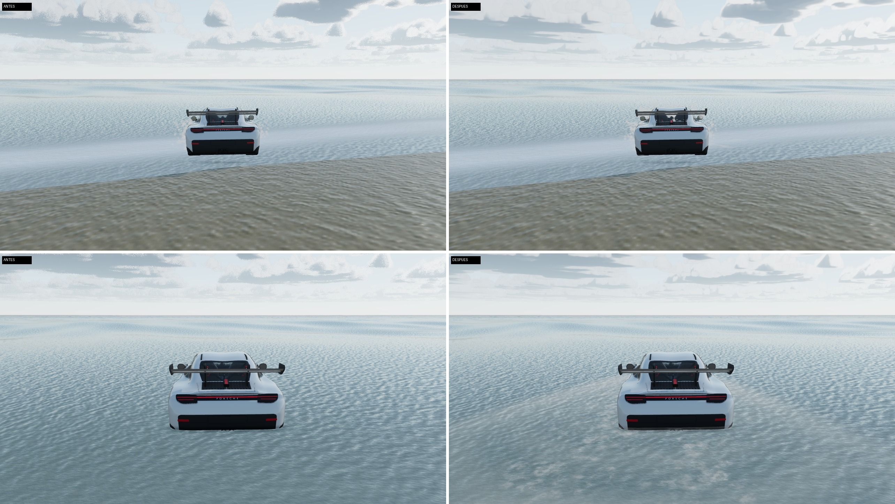
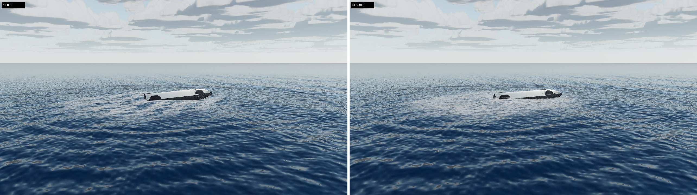

# Auditoría externa de ChatGPT (8-11-2026): trabajo hecho

Encargo: `docs/auditorias-externas/2026-11-08-chatgpt.md` (y su `.docx`). Su «Encargo prioritario» manda sobre
el resto. Las capturas de esta ronda están en `docs/auditoria-2026-11-08-chatgpt/`: 1280 × 720 por toma, PNG
convertido a JPEG de calidad 92, «antes» (commit `778580d`) a la izquierda y «después» a la derecha, con la
misma cámara, la misma hora y el mismo sol. Se tomaron con SwiftShader (render por software) en calidad alta
con `?clouds=full`. **No hay ninguna cifra de FPS:** en este contenedor no hay GPU, así que el coste en el
equipo de Álvaro queda por medir.

## Bloque 1

### 1. Regla de calidad: sin bajadas automáticas ni LOD en el modo normal (hallazgos 01 y 13)

- **Calidad adaptativa retirada.** Se borra `src/core/adaptive.js`, que bajaba los pasos de las nubes
  cuando los fotogramas iban lentos y, a 60 Hz con sincronización vertical, ya no volvía a subirlos.
  Ya nada lee los tiempos de fotograma para cambiar la calidad.
- **El nivel de partida es siempre el alto.** `quality.js` ya no rebaja por su cuenta a teléfonos,
  renderizadores por software ni equipos con poca memoria. Lo que la sonda habría elegido solo se
  muestra (`tier.suggested`, en el panel técnico). Solo `?quality=medium|low` cambia el nivel.
- **Sin LOD en calidad alta** (`lodPixels: 0`). `LODManager` mantiene todo el detalle a cualquier
  distancia. Los neumáticos del Model Y vuelven a tener la malla completa: se borra `latheLod.js`.
- **El panel técnico (I)** enseña el búfer real (píxeles, relación de píxeles, MSAA) y el estado del LOD.
- **Pruebas:**
  - `tools/quality-check.mjs` sustituye a `adaptive-check.mjs` en `check:static`. Comprueba que el
    nivel de partida es el alto con cuatro dispositivos simulados (escritorio a 144 Hz, teléfono,
    SwiftShader y portátil de 4 GB), que una entrada de LOD a 10 km conserva el detalle y que nadie
    escribe `clouds.steps` en marcha. Lleva controles negativos.
  - `check.mjs` exige que ninguna entrada de LOD pierda detalle en la vista general. La prueba de que
    el LOD no altera las medidas sigue en pie, con el umbral antiguo puesto solo durante esa prueba.
  - `lod-pop`, `lod-parts` y `lod-sweep` pasan a medir el nivel medio, que es donde aún hay LOD.
- **Coste:** la vista general dibuja ≈520 000 triángulos más solo por los neumáticos, más todo lo que
  antes ocultaba el LOD. Los presupuestos de triángulos construidos no cambian: al quitar las copias
  lejanas, el total construido baja.

### 2. Retardo del sonido con la nave supersónica (hallazgo 02)

- **Reproducido:** con `t = entrada + 300 s` y la cámara en `{0, 2, 1000}`, `heardAt` daba
  τ ≈ −1,72 × 10¹⁷ s.
- **Corrección:** la raíz de f(τ) = τ + d(τ)/c − t se busca en [`TAU_MIN`, t] con pasos f/L, donde
  L = 1 + v_máx/c. Con ese paso no se salta ninguna raíz y se obtiene la más reciente.
  - Si no hay raíz, la función devuelve `heard: false`: el sonido aún no ha llegado.
  - Siempre devuelve el residuo.
- **Prueba:** 48 casos (hipersónico, supersónico, Mach 1; cámaras en el suelo y en vuelo), con un
  barrido por fuerza bruta que confirma la raíz o que de verdad no hay llegada, y un control negativo
  con la iteración antigua.
- **Hallazgo 03:** el estampido queda marcado como efecto de puesta en escena (≈). Mach 1,2 es una
  elección.

### 3. Sondas de reflejo con `try/finally` (hallazgo 11)

`captureOne` restaura siempre la visibilidad, los indicadores del mapa de sombras y la cámara que sigue
el cielo. `probe-check.mjs` inyecta una excepción en la captura y comprueba que todo queda como estaba.

### 4. Nubes del cielo sin grano (prioridad 2)

- **Causa:** la capa se partía en 32 pasos iguales, de hasta 500 m cerca del horizonte, con un desfase
  de ruido blanco por píxel. Las nubes tienen detalle de 60–340 m.
- **Ahora:**
  - El aire vacío se cruza con pasos largos, que solo leen la cobertura y la altura que puede alcanzar
    una nube en ese punto.
  - Donde puede haber nube, el rayo retrocede y sigue con pasos cortos: 1/5 000 de la distancia,
    entre 18 y 70 m.
  - El desfase sale de un ruido de gradiente entrelazado (baja discrepancia).
  - Hay 5 muestras de luz (antes 3) y un término de luz dispersada hacia delante.
  - El tope es de 256 iteraciones en calidad alta y 120 en media (antes 32 y 20). Bajo automatización
    se usan 12, antes 6.
- **Resultado:**
  - Desde el suelo y dentro de la nube desaparece el moteado.
  - Desde arriba ya no hay grano, pero las cimas siguen en cono. Probé una forma con torreones y
    empeoraba (picos más finos), así que la descarté.
  - Quedan alguna mota aislada cerca del horizonte desde arriba y un aspecto algo liso de cerca.
- **Coste en la GPU real sin medir.** Es el cambio más caro de la ronda.

### 5. Nube del encendido menos de dibujo (prioridad 3; mejora moderada)

- **El atlas de bocanadas:**
  - Ahora es de 256 px por celda (antes 192).
  - Antes de medir los lóbulos, el punto se deforma con un campo fractal a dos escalas: ningún
    contorno es un arco de círculo.
  - El borde se difumina en una rampa más ancha (0,27 frente a 0,2).
  - El relieve de sombreado baja de 0,6 a 0,45.
- **El sombreador:**
  - El 30 % de la luz es la de la masa, no la de cada lóbulo. Así deja de sombrear cada bolita por
    separado.
  - Cada bocanada varía ±8 % en tono y densidad.
- **Resultado:** la masa se lee más continua y sin el contorno de coliflor recortado. Sigue siendo un
  sistema de sprites: unas masas turbulentas de verdad (volumen) son un trabajo pendiente.

### 6. El amerizaje: oleaje, ondas del impacto y una nave que flotaba en el aire (prioridad 4)

- **Fallo previo encontrado (también en la galería oficial, `reentry-splash.jpg`):**
  - Tras amerizar, la nave quedaba ≈70 m por encima del mar (malla medida entre 70 y 122 m).
  - Causa: `launch.reset()` se ejecuta aunque el lanzamiento no esté en marcha, y devolvía la nave a
    su altura sobre el propulsor (71,93 m) aunque en ese momento la tuviera prestada la reentrada.
  - Corregido en `launch.js`: solo mueve la nave si es suya.
  - Regresión añadida en `ux-check.mjs`.
- **Oleaje en mar abierto:**
  - El disco plano con normales animadas pasa a ser las seis ondas de Gerstner de la costa
    (`ocean.js`, `open: true`), con `OPEN_SEA_AMP` 1,8 (≈ Hs 1,6 m, **elegido**: el estado del mar
    del amerizaje no está publicado).
  - Se dibujan en una malla polar de 3 km que sigue a la cámara, en el marco del agua. El disco plano
    le cede el sitio dentro de su radio.
  - El reloj de las olas es el de la misión, así que buscar y pausar ven el mismo mar.
- **Ondas del impacto:**
  - Un paquete anular desde el punto de amerizaje y otro lineal desde el golpe del casco. Mismo frente
    que la espuma (≈ 5 m/s), ≈1,3 m y 1,0 m, amortiguados en decenas de segundos. Son ≈, no medidos.
  - La espuma va sobre la misma superficie y la nave flota en la altura de la ola.
- **Pendiente:** los vehículos que entran en el agua en la costa (Porsche, H2R, F-16) siguen con su
  efecto anterior.

### 7. Misión, horas y fuentes (hallazgos 04, 05, 06 y 07)

- **La nota de la reentrada:**
  - Dice que el capítulo es un **plan hipotético**.
  - Calcula y muestra la entrada que predice la cadena (≈T+9:06:54) frente a la del plan
    (T+9:28:56), y el **salto de ≈22 min** entre ambas.
  - Las horas del vuelo real (T+2:12:00–2:12:11, T+2:28:52) figuran como de Wikipedia, consultada el
    8-11-2026, **sin verificar** en fuente primaria y con incertidumbre desconocida.
  - La cadena «tal como voló» es una comparación bajo sus propios supuestos, no una validación.
  - `mission-check` usa ese mismo rótulo.
- **Comentarios corregidos:**
  - `launchModel.js`: el apagado circular de 200 km no es el del vuelo 14. El vuelo real llegó a
    262 × 275 km y duró ≈3 h, y no se reproduce el apagado prematuro del Raptor Vacuum.
  - El total de 1 614 tf no es la suma 3 × 250 + 3 × 275 = 1 575 tf.
  - Los 250 tf son el empuje a nivel del mar, aplicado en vacío: son una cota inferior.
- **§31:** `tools/f14-insertion-dv.mjs` reproduce las cifras sin redondear. Detalle en las respuestas.

## Bloque 2 (9-11-2026, tras el CI y Pages en verde de `5eddd88`)

- **Hallazgo 10:**
  - `fogSun.js` falla al arrancar si un fragmento de three.js ya no tiene la línea que parchea; antes
    se perdía en silencio.
  - `sunlight-check.mjs` comprueba que dos materiales clonados leen el mismo `Float32Array` y que una
    escritura llega a ambos.
- **Hallazgos 12 y 15:**
  - §28 del diario queda como «sin crecimiento de esos contadores en los ciclos ensayados».
  - Las 66 capturas se presentan como una muestra.
  - El primer punto del traspaso ya no propone bloques ya hechos.
- **Amerizaje:**
  - La línea clara del horizonte era el anillo exterior de la malla del oleaje, a 3 km. Probé dos
    arreglos que no la quitaron: que el disco ceda justo el polígono y un desplazamiento de
    profundidad. Se mantienen igualmente porque evitan solapes.
  - Lo que la quita es llevar el borde a 12 km, dentro de la bruma: unos 15 000 vértices más, y el
    oleaje llega más lejos.

## Bloque 3 (9-11-2026): vehículos en el agua y hallazgos 08, 09 y 14

- **Marcas en el agua** (`src/core/waterMarks.js`, nuevo): parches de espuma y anillos de onda.
  - Van sobre la superficie que se mueve: se leen a la altura que lee la física (`ground().water`).
  - Se usan en el Porsche (estela de cada rueda y espuma de proa), en la H2R (estela de cada rueda)
    y en el F-16 (anillos y espuma a lo largo del amerizaje o del choque contra el agua).
  - La entrada (`splashInto`) lanza una corona de gotas y láminas hacia arriba y hacia delante,
    proporcional a la velocidad, más dos anillos y un parche de espuma.
  - Valores ≈ (aspecto, no simulación de fluidos).
- **Resultado en las capturas:**
  - La estela de espuma con forma de encaje se aprecia claramente; antes no quedaba nada sobre el
    agua.
  - La corona de la entrada apenas destaca sobre las gotas que ya lanzaban las ruedas: mejora pequeña.
  - El primer intento de espuma salió como una banda blanca y opaca que parecía niebla. Se corrigió
    con más huecos y menos opacidad.
- **Hallazgo 08, la atmósfera de la reentrada.**
  - La densidad era un ajuste de dos exponenciales, hasta un 78 % más densa que la US Standard
    Atmosphere 1976 entre 30 y 50 km. Ahora es la tabla de la USSA 1976, interpolada en logaritmo.
  - Comprobación independiente en `mission-check.mjs`: la misma norma calculada por capas
    (temperaturas, gradientes, presión hidrostática, ρ = pM/RT) en los puntos intermedios. Error
    máximo 1,6 %; el ajuste anterior hace de control negativo.
  - Esa comprobación detectó un nodo mal en la tabla que yo mismo había escrito: a 85 km había puesto
    el valor de 86 km. Corregido.
  - Los coeficientes de la reentrada se vuelven a resolver al cargar y siguen cumpliendo las horas
    citadas. La presión dinámica máxima pasa de 5,0 kPa (11,8 km) a 5,3 kPa (11,2 km). Es una salida
    del modelo, no una medida.
- **Hallazgo 09, la luz del sol.**
  - La fórmula de Rayleigh del código se atribuía a Bodhaine et al. (1999), pero es la de Hansen y
    Travis (1974). Cita corregida.
  - La prueba compara ahora los valores de producción con la ecuación 30 de Bodhaine, un ajuste
    distinto calculado aparte. Error máximo 0,28 %, con un control en λ⁻³.
  - `sunlight.js` y `fogSun.js` se describen como aproximación visual con componentes físicos; el
    lóbulo cos⁶ no es Henyey–Greenstein.
- **Hallazgo 14, `launchModel.js`.**
  - Ya no importa three.js ni los constructores de vehículos. Las cifras del propulsor y de la
    plataforma pasan a `src/data/stackFigures.js` y `src/data/padFigures.js`, y las curvas
    monótonas a `src/geometry/curves.js`; los módulos de origen las reexportan.
  - `mission.js` importa el modelo directamente.
  - Resultado comprobado idéntico bit a bit: 8 275 valores, mismo SHA-256 antes y después.
  - `mission-check.mjs` carga el modelo en un Node sin ganchos para que no vuelva a acoplarse.
  - Los archivos largos (`roadster.js`, `gt3rs.js`, `main.js`) no se han partido en esta ronda.

## Bloque 4 (9-11-2026): el humo del encendido como un solo cuerpo

- **Campo de densidad 3D en coordenadas del mundo** (`plume.js`, `CLOUD_FRAG`).
  - Lo comparten todas las bocanadas que se solapan en un punto: adelgazan y se espesan a la vez.
  - La masa gana núcleos densos y calles finas de unas decenas de metros, en vez de leerse como
    copias de 16 celdas del atlas.
  - Donde el campo es espeso, el vapor se sombrea a sí mismo un poco (≈ autoocultación); donde es
    fino, deja pasar la luz.
- **Borboteo:** la textura de cada bocanada se deforma dentro de su celda según su edad, así que la
  superficie se revuelve mientras vive. Usa la edad y no un reloj, para que saltar en el tiempo dé
  el mismo fotograma.
- **Resultado:** se aprecia mejor la masa continua y variada. Algunas zonas quedan más transparentes
  que antes.
- **Sigue siendo un sistema de sprites.** Un volumen trazado de verdad (masas turbulentas con
  dispersión real) queda pendiente: pide una pasada propia y medir su coste en GPU real.

## Crítica del subagente (9-11-2026) y su bloque 1: solidez, correcciones claras y documentación

Álvaro pidió a un subagente (Haiku, solo lectura) una crítica ambiciosa del repositorio: 6 hallazgos
altos, 16 medios y 7 bajos, más diez mejoras visuales. Su orden posterior: hacerlas todas en tres
bloques, menos el amerizaje del propulsor (el propulsor acaba en la torre y solo la nave cae al mar),
y sin bajar calidad. Primero se comprobó cada hallazgo en el código. Este es el bloque 1.

- **Fallo del CI del bloque 4 (`377e5c1`):**
  - Era el trabajo de interfaz: la captura de 1366 × 768 superaba el límite de 120 s.
  - En esta máquina falla igual con los bloques 2, 3 y 4, así que no es un fallo funcional: el
    render por software está al límite con la calidad completa.
  - El límite pasa a 300 s (`SHOT_MS` en `tools/ux-check.mjs`): se sube el límite, no se baja la imagen.
  - En `tools/check.mjs`, por el mismo motivo, las esperas por defecto y la explícita de 30 s pasan
    a 180 s.
  - En local, con todo el bloque, `ux-check` sale en verde (90 comprobaciones, código 0) y
    `check.mjs` también (código 0). Para ejecutarlos aquí hizo falta un gancho fuera del
    repositorio que apunta Playwright al navegador del entorno.
- **A1, barrera de errores (`main.js`):**
  - El siguiente fotograma se pide al principio.
  - Cada parte del fotograma va protegida: cámara, secuencias, vuelo, conducción, sonido, sondas,
    render y etiquetas.
  - Un fallo se registra en la consola y se avisa una vez en el HUD, y lo demás sigue.
  - Hay manejadores globales de `error` y `unhandledrejection`; los fallos se cuentan en
    `__vc.frameErrors`.
  - `check.mjs` inyecta un fallo en la actualización del lanzamiento y exige que quede anotado en
    tres fotogramas seguidos.
- **A6, el README:** las secciones «Nivel de detalle» y «Niveles de calidad» dicen ya que en calidad
  alta no hay LOD ni adaptación. No se había bajado la calidad: el texto se había quedado antiguo.
- **A5, la nave amerizada cabecea con la ola:**
  - Se ajusta una línea de flotación a cinco estaciones de los 52 m del casco (`ocean.js
    openWaterline`). El casco toma su pendiente y la altura en el centro de masas.
  - Holgura media frente al agua a lo largo del casco: 32 cm, frente a 62 cm con un solo punto
    (`ocean-check.mjs`).
  - ≈, sin flotabilidad.
  - Comparativa (sutil: la popa se asienta en la ola en vez de quedar posada a una sola altura):
    
- **M1, cambio de pantalla:** si la ventana pasa a un monitor con otra densidad de píxeles, la
  resolución del búfer se vuelve a ajustar (hasta el tope de 2 de la calidad alta).
- **M2, reflejo del Lab:** se crea y se mantiene a resolución física completa. Antes nacía a la mitad
  y saltaba al doble al redimensionar.
- **M3, espuma sobre la ola:** cada mancha se inclina con la pendiente del mar bajo ella.
- **B2, azar con semilla:** las marcas y la salpicadura usan un generador con semilla que `clear()`
  reinicia.
- **M5 y M6, nubes:** el corte a 40 km se funde en los últimos 15 km, y la sombra de las nubes entra
  con una rampa entre 1,1° y 4,6° de sol, en vez de apagarse de golpe a 2,9°.
- **M7, espuma del amerizaje:** desplazamiento de profundidad para que no parpadee contra el mar de
  lejos.
- **M8, sonido:**
  - `soundSpeedAt` sigue las capas de la USSA 1976 también por encima de 47 km. Antes se quedaba en
    270,65 K hasta el espacio; ahora llega a ≈187 K a 86 km.
  - El tiempo de viaje del sonido integra 1/c(h) a lo largo del camino. Antes era una constante de
    343 m/s; a 3,43 km, a nivel del mar, el retardo es ya 10,08 s.
- **M14, pruebas del sonido:** el resolutor (`solveEmission`) es una función pura con la trayectoria
  inyectable. Se prueba con la solución cerrada de una fuente en vuelo recto, subsónica y
  supersónica, dentro y fuera del cono de Mach: 24 casos.
- **M10, Starlink:** los 4,1 m pasan a `breadth` (anchura del cuerpo). La altura no está publicada y
  queda sin dato.
- **M11, Falcon 9:** comprobado y correcto. La verificación mide la cofia (casco con cofia) frente a
  los 5,2 m de la cofia; el cuerpo de 3,66 m solo figura como texto.
- **M13, pruebas de nubes:**
  - `cloud-check.mjs` pasa a llamarse `launch-regressions-check.mjs`, porque prueba el lanzamiento y
    la reentrada.
  - Nuevo `sky-clouds-check.mjs`: reproduce en JS el marcado sobre la cobertura real (el mismo ruido)
    en 4 500 rayos.
  - Encontró que el 14 % de los rayos bajos superaba el tope de 256 iteraciones y quedaba cortado:
    eran las motas cerca del horizonte.
  - El tope pasa a 640 en calidad alta, que cubre el percentil 99 (546), y a 384 en la media.
- **B3, olas:** van con el tiempo de pared, como los vehículos que las cruzan.
- **M16:** no se reproduce. La hierba de las dunas, que se mueve en el sombreador, no proyecta
  sombra, y la manga de viento se mueve con su transformación, que la firma de la escena detecta.
- **B1:** los archivos «huérfanos» de `tools/` son manifiestos manuales de `shot.mjs` y herramientas
  manuales. No se borran; quedan descritos en la «Estructura» del README.
- **B5:** el aviso de la pantalla de carga sigue siendo cierto (sin adaptación automática a móviles).
- **Para el bloque 2:** sombras en cascada o PCSS (A2), olas lejanas por píxel (A3), antialiasing
  temporal y reproyección de nubes (M4), texturas de 2048 (M9), acero cepillado, barniz y reflejos
  en pantalla.
- **Para el bloque 3:**
  - humo volumétrico, fuego por temperatura y anillos del chorro, salpicadura horneada en Blender,
    atmósfera física;
  - módulo común de ruido (M12), partir los archivos largos (M15), hash sin seno (B4), three.js (B6)
    y accesibilidad (B7).

## Respuestas a las «Preguntas para Claude»

1. **Script de §31 y los 177 m/s.**
   - `node tools/f14-insertion-dv.mjs` da por vis viva, con μ estándar / μ del código:
     −300 km → 173,350 / 173,230 m/s; −90 → 106,346; −32 → 88,322; +27 → 70,196; +87 → 51,973. Cuadra
     con la auditoría.
   - Los 177,270 m/s son el Δv de la hipótesis de la inserción: 250 tf, Isp 350 s, 19 s y 269,6 t al
     apagado del modelo.
   - Ese Δv corresponde a un perigeo de **−312,4 km**, no de −300. La fila mezclaba el Δv de la
     hipótesis con un perigeo redondeado de forma grosera.
   - La altitud de apagado de 76 km salió de una copia del integrador que se borró: no se puede
     reproducir aquí. La conclusión queda como «dentro de este modelo y estas restricciones».
2. **Fuente de T+2:12:00–2:12:11 y T+2:28:52.** La única fuente leída es Wikipedia («Starship flight
   14»), que cita a SpaceX y a la prensa. No tengo una fuente primaria ni una marca temporal de la
   retransmisión verificadas, así que su incertidumbre es desconocida. La interfaz las marca ya como
   «not verified».
3. **Reducciones automáticas desactivadas:**
   - la calidad adaptativa de las nubes;
   - la bajada automática de nivel por dispositivo;
   - el LOD del nivel alto, incluidos los neumáticos del Model Y.

   Cómo se ha comprobado: `quality-check.mjs` (contratos y controles negativos, en `check:static`),
   `check.mjs` (ninguna entrada retirada en la vista general) y el panel técnico, que muestra el búfer,
   el MSAA y el LOD reales.
4. **La captura que Álvaro percibe menos nítida:** no la conozco. Me falta saber la captura, el
   dispositivo, la resolución, el navegador y la versión. Lo que sí se ha comprobado:
   - el compositor se dimensiona por la relación de píxeles (`composer.setSize`, corregido en una
     ronda anterior);
   - en calidad alta, la relación es min(2, DPR del dispositivo), con MSAA 4×;
   - el grano de las nubes era real y se veía a resolución completa (comparativa arriba).

   Con esos datos se puede reproducir la captura frente a `778580d` con el arnés de esta ronda.
5. **Qué sirve Pages y pruebas en GPU real:** el despliegue de cada push se comprueba al cerrar el
   bloque (ver más abajo). No hay pruebas en GPU real, tampoco del Lab: no hay GPU en el contenedor.
   Queda para el equipo de Álvaro, con `?perf=log` y el panel técnico (I).

## Límites y pendientes

- FPS y coste en la RTX 3070 sin medir. El marcado de nubes nuevo y la geometría completa son lo que
  más puede costar. Si hay problemas, se deciden con Álvaro, sin bajar la calidad.
- Nubes: cimas en cono vistas desde arriba y alguna mota cerca del horizonte.
- Humo: sigue siendo de sprites; mejora moderada.
- Agua: la corona de entrada de los coches es discreta.
- El `npm run check` completo no se ha corrido en local (más de 1 h por software): se usa el CI.
