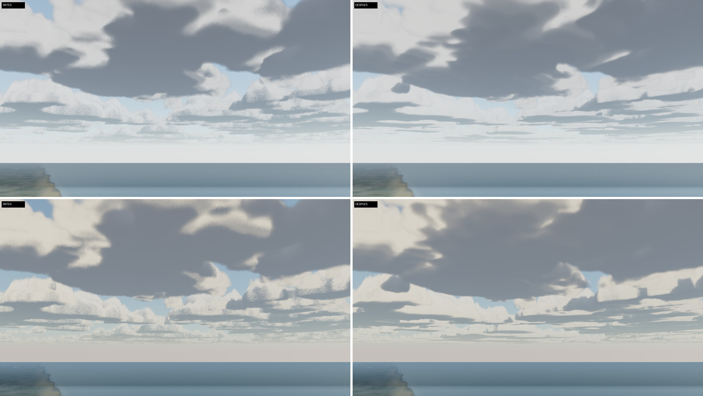
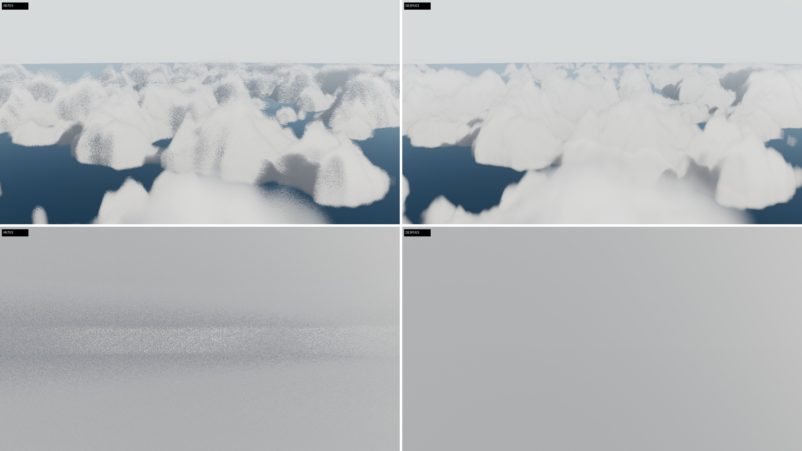
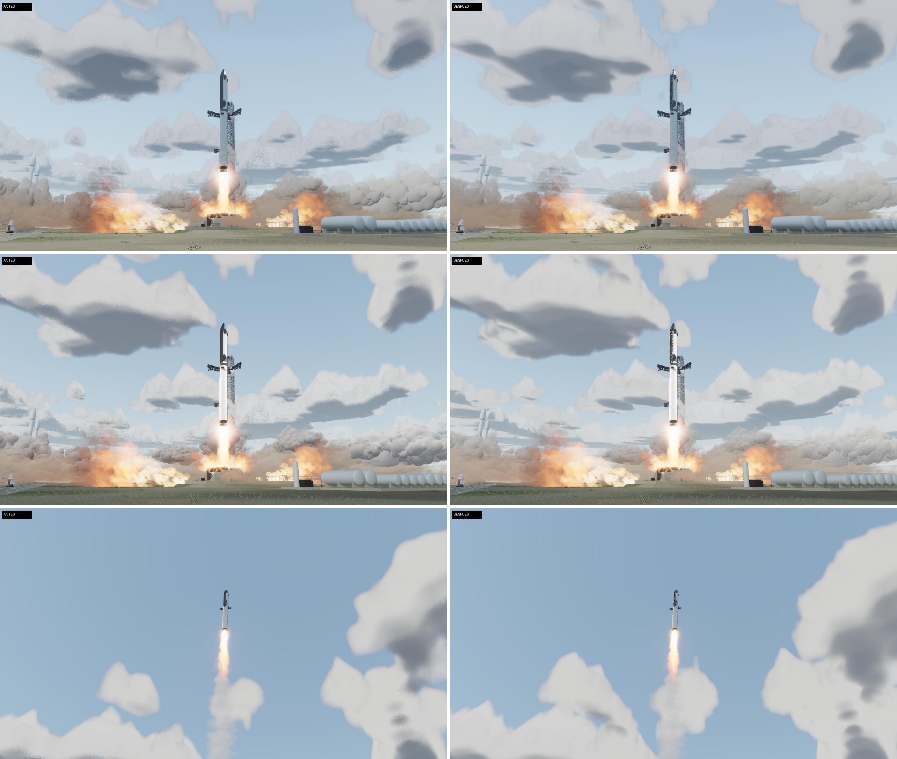
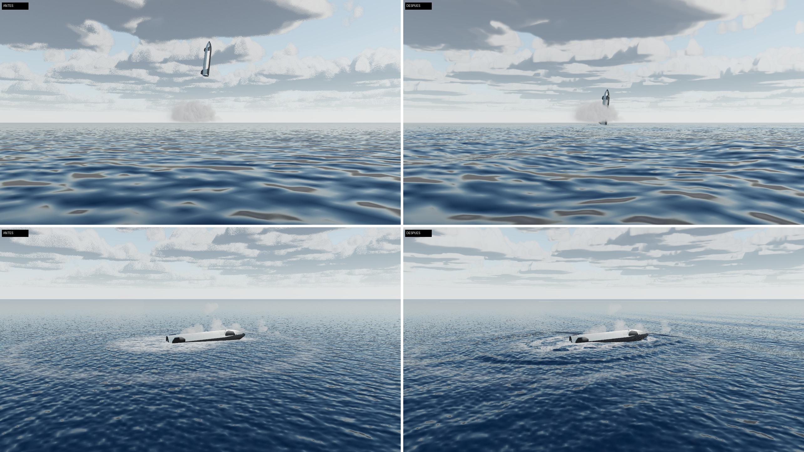

# Auditoría externa de ChatGPT (8-11-2026): trabajo hecho

Encargo: `docs/auditorias-externas/2026-11-08-chatgpt.md` (y su `.docx`). Su «Encargo prioritario» manda sobre
el resto. Las capturas de esta ronda están en `docs/auditoria-2026-11-08-chatgpt/`: 1280 × 720 por toma, PNG
convertido a JPEG de calidad 92, «antes» (commit `778580d`) a la izquierda y «después» a la derecha, con la
misma cámara, la misma hora y el mismo sol. Se tomaron con SwiftShader (render por software) en calidad alta
con `?clouds=full`. **No hay ninguna cifra de FPS:** en este contenedor no hay GPU, así que el coste en el
equipo de Álvaro queda por medir.

## Bloque 1

### 1. Regla de calidad: sin bajadas automáticas ni LOD en el modo normal (hallazgos 01 y 13)

- **Calidad adaptativa retirada.** Se borra `src/core/adaptive.js`, que bajaba los pasos de las nubes
  cuando los fotogramas iban lentos y, a 60 Hz con sincronización vertical, ya no volvía a subirlos.
  Ya nada lee los tiempos de fotograma para cambiar la calidad.
- **El nivel de partida es siempre el alto.** `quality.js` ya no rebaja por su cuenta a teléfonos,
  renderizadores por software ni equipos con poca memoria. Lo que la sonda habría elegido solo se
  muestra (`tier.suggested`, en el panel técnico). Solo `?quality=medium|low` cambia el nivel.
- **Sin LOD en calidad alta** (`lodPixels: 0`). `LODManager` mantiene todo el detalle a cualquier
  distancia. Los neumáticos del Model Y vuelven a tener la malla completa: se borra `latheLod.js`.
- **El panel técnico (I)** enseña el búfer real (píxeles, relación de píxeles, MSAA) y el estado del LOD.
- **Pruebas:**
  - `tools/quality-check.mjs` sustituye a `adaptive-check.mjs` en `check:static`. Comprueba que el
    nivel de partida es el alto con cuatro dispositivos simulados (escritorio a 144 Hz, teléfono,
    SwiftShader y portátil de 4 GB), que una entrada de LOD a 10 km conserva el detalle y que nadie
    escribe `clouds.steps` en marcha. Lleva controles negativos.
  - `check.mjs` exige que ninguna entrada de LOD pierda detalle en la vista general. La prueba de que
    el LOD no altera las medidas sigue en pie, con el umbral antiguo puesto solo durante esa prueba.
  - `lod-pop`, `lod-parts` y `lod-sweep` pasan a medir el nivel medio, que es donde aún hay LOD.
- **Coste:** la vista general dibuja ≈520 000 triángulos más solo por los neumáticos, más todo lo que
  antes ocultaba el LOD. Los presupuestos de triángulos construidos no cambian: al quitar las copias
  lejanas, el total construido baja.

### 2. Retardo del sonido con la nave supersónica (hallazgo 02)

- **Reproducido:** con `t = entrada + 300 s` y la cámara en `{0, 2, 1000}`, `heardAt` daba
  τ ≈ −1,72 × 10¹⁷ s.
- **Corrección:** la raíz de f(τ) = τ + d(τ)/c − t se busca en [`TAU_MIN`, t] con pasos f/L, donde
  L = 1 + v_máx/c. Con ese paso no se salta ninguna raíz y se obtiene la más reciente.
  - Si no hay raíz, la función devuelve `heard: false`: el sonido aún no ha llegado.
  - Siempre devuelve el residuo.
- **Prueba:** 48 casos (hipersónico, supersónico, Mach 1; cámaras en el suelo y en vuelo), con un
  barrido por fuerza bruta que confirma la raíz o que de verdad no hay llegada, y un control negativo
  con la iteración antigua.
- **Hallazgo 03:** el estampido queda marcado como efecto de puesta en escena (≈). Mach 1,2 es una
  elección.

### 3. Sondas de reflejo con `try/finally` (hallazgo 11)

`captureOne` restaura siempre la visibilidad, los indicadores del mapa de sombras y la cámara que sigue
el cielo. `probe-check.mjs` inyecta una excepción en la captura y comprueba que todo queda como estaba.

### 4. Nubes del cielo sin grano (prioridad 2)

- **Causa:** la capa se partía en 32 pasos iguales, de hasta 500 m cerca del horizonte, con un desfase
  de ruido blanco por píxel. Las nubes tienen detalle de 60–340 m.
- **Ahora:**
  - El aire vacío se cruza con pasos largos, que solo leen la cobertura y la altura que puede alcanzar
    una nube en ese punto.
  - Donde puede haber nube, el rayo retrocede y sigue con pasos cortos: 1/5 000 de la distancia,
    entre 18 y 70 m.
  - El desfase sale de un ruido de gradiente entrelazado (baja discrepancia).
  - Hay 5 muestras de luz (antes 3) y un término de luz dispersada hacia delante.
  - El tope es de 256 iteraciones en calidad alta y 120 en media (antes 32 y 20). Bajo automatización
    se usan 12, antes 6.
- **Resultado:**
  - Desde el suelo y dentro de la nube desaparece el moteado.
  - Desde arriba ya no hay grano, pero las cimas siguen en cono. Probé una forma con torreones y
    empeoraba (picos más finos), así que la descarté.
  - Quedan alguna mota aislada cerca del horizonte desde arriba y un aspecto algo liso de cerca.
- **Coste en la GPU real sin medir.** Es el cambio más caro de la ronda.

### 5. Nube del encendido menos de dibujo (prioridad 3; mejora moderada)

- **El atlas de bocanadas:**
  - Ahora es de 256 px por celda (antes 192).
  - Antes de medir los lóbulos, el punto se deforma con un campo fractal a dos escalas: ningún
    contorno es un arco de círculo.
  - El borde se difumina en una rampa más ancha (0,27 frente a 0,2).
  - El relieve de sombreado baja de 0,6 a 0,45.
- **El sombreador:**
  - El 30 % de la luz es la de la masa, no la de cada lóbulo. Así deja de sombrear cada bolita por
    separado.
  - Cada bocanada varía ±8 % en tono y densidad.
- **Resultado:** la masa se lee más continua y sin el contorno de coliflor recortado. Sigue siendo un
  sistema de sprites: unas masas turbulentas de verdad (volumen) son un trabajo pendiente.

### 6. El amerizaje: oleaje, ondas del impacto y una nave que flotaba en el aire (prioridad 4)

- **Fallo previo encontrado (también en la galería oficial, `reentry-splash.jpg`):**
  - Tras amerizar, la nave quedaba ≈70 m por encima del mar (malla medida entre 70 y 122 m).
  - Causa: `launch.reset()` se ejecuta aunque el lanzamiento no esté en marcha, y devolvía la nave a
    su altura sobre el propulsor (71,93 m) aunque en ese momento la tuviera prestada la reentrada.
  - Corregido en `launch.js`: solo mueve la nave si es suya.
  - Regresión añadida en `ux-check.mjs`.
- **Oleaje en mar abierto:**
  - El disco plano con normales animadas pasa a ser las seis ondas de Gerstner de la costa
    (`ocean.js`, `open: true`), con `OPEN_SEA_AMP` 1,8 (≈ Hs 1,6 m, **elegido**: el estado del mar
    del amerizaje no está publicado).
  - Se dibujan en una malla polar de 3 km que sigue a la cámara, en el marco del agua. El disco plano
    le cede el sitio dentro de su radio.
  - El reloj de las olas es el de la misión, así que buscar y pausar ven el mismo mar.
- **Ondas del impacto:**
  - Un paquete anular desde el punto de amerizaje y otro lineal desde el golpe del casco. Mismo frente
    que la espuma (≈ 5 m/s), ≈1,3 m y 1,0 m, amortiguados en decenas de segundos. Son ≈, no medidos.
  - La espuma va sobre la misma superficie y la nave flota en la altura de la ola.
- **Pendiente:** los vehículos que entran en el agua en la costa (Porsche, H2R, F-16) siguen con su
  efecto anterior.

### 7. Misión, horas y fuentes (hallazgos 04, 05, 06 y 07)

- **La nota de la reentrada:**
  - Dice que el capítulo es un **plan hipotético**.
  - Calcula y muestra la entrada que predice la cadena (≈T+9:06:54) frente a la del plan
    (T+9:28:56), y el **salto de ≈22 min** entre ambas.
  - Las horas del vuelo real (T+2:12:00–2:12:11, T+2:28:52) figuran como de Wikipedia, consultada el
    8-11-2026, **sin verificar** en fuente primaria y con incertidumbre desconocida.
  - La cadena «tal como voló» es una comparación bajo sus propios supuestos, no una validación.
  - `mission-check` usa ese mismo rótulo.
- **Comentarios corregidos:**
  - `launchModel.js`: el apagado circular de 200 km no es el del vuelo 14. El vuelo real llegó a
    262 × 275 km y duró ≈3 h, y no se reproduce el apagado prematuro del Raptor Vacuum.
  - El total de 1 614 tf no es la suma 3 × 250 + 3 × 275 = 1 575 tf.
  - Los 250 tf son el empuje a nivel del mar, aplicado en vacío: son una cota inferior.
- **§31:** `tools/f14-insertion-dv.mjs` reproduce las cifras sin redondear. Detalle en las respuestas.

## Bloque 2 (9-11-2026, tras el CI y Pages en verde de `5eddd88`)

- **Hallazgo 10:**
  - `fogSun.js` falla al arrancar si un fragmento de three.js ya no tiene la línea que parchea; antes
    se perdía en silencio.
  - `sunlight-check.mjs` comprueba que dos materiales clonados leen el mismo `Float32Array` y que una
    escritura llega a ambos.
- **Hallazgos 12 y 15:**
  - §28 del diario queda como «sin crecimiento de esos contadores en los ciclos ensayados».
  - Las 66 capturas se presentan como una muestra.
  - El primer punto del traspaso ya no propone bloques ya hechos.
- **Amerizaje:**
  - La línea clara del horizonte era el anillo exterior de la malla del oleaje, a 3 km. Probé dos
    arreglos que no la quitaron: que el disco ceda justo el polígono y un desplazamiento de
    profundidad. Se mantienen igualmente porque evitan solapes.
  - Lo que la quita es llevar el borde a 12 km, dentro de la bruma: unos 15 000 vértices más, y el
    oleaje llega más lejos.

## Respuestas a las «Preguntas para Claude»

1. **Script de §31 y los 177 m/s.**
   - `node tools/f14-insertion-dv.mjs` da por vis viva, con μ estándar / μ del código:
     −300 km → 173,350 / 173,230 m/s; −90 → 106,346; −32 → 88,322; +27 → 70,196; +87 → 51,973. Cuadra
     con la auditoría.
   - Los 177,270 m/s son el Δv de la hipótesis de la inserción: 250 tf, Isp 350 s, 19 s y 269,6 t al
     apagado del modelo.
   - Ese Δv corresponde a un perigeo de **−312,4 km**, no de −300. La fila mezclaba el Δv de la
     hipótesis con un perigeo redondeado de forma grosera.
   - La altitud de apagado de 76 km salió de una copia del integrador que se borró: no se puede
     reproducir aquí. La conclusión queda como «dentro de este modelo y estas restricciones».
2. **Fuente de T+2:12:00–2:12:11 y T+2:28:52.** La única fuente leída es Wikipedia («Starship flight
   14»), que cita a SpaceX y a la prensa. No tengo una fuente primaria ni una marca temporal de la
   retransmisión verificadas, así que su incertidumbre es desconocida. La interfaz las marca ya como
   «not verified».
3. **Reducciones automáticas desactivadas:**
   - la calidad adaptativa de las nubes;
   - la bajada automática de nivel por dispositivo;
   - el LOD del nivel alto, incluidos los neumáticos del Model Y.

   Cómo se ha comprobado: `quality-check.mjs` (contratos y controles negativos, en `check:static`),
   `check.mjs` (ninguna entrada retirada en la vista general) y el panel técnico, que muestra el búfer,
   el MSAA y el LOD reales.
4. **La captura que Álvaro percibe menos nítida:** no la conozco. Me falta saber la captura, el
   dispositivo, la resolución, el navegador y la versión. Lo que sí se ha comprobado:
   - el compositor se dimensiona por la relación de píxeles (`composer.setSize`, corregido en una
     ronda anterior);
   - en calidad alta, la relación es min(2, DPR del dispositivo), con MSAA 4×;
   - el grano de las nubes era real y se veía a resolución completa (comparativa arriba).

   Con esos datos se puede reproducir la captura frente a `778580d` con el arnés de esta ronda.
5. **Qué sirve Pages y pruebas en GPU real:** el despliegue de cada push se comprueba al cerrar el
   bloque (ver más abajo). No hay pruebas en GPU real, tampoco del Lab: no hay GPU en el contenedor.
   Queda para el equipo de Álvaro, con `?perf=log` y el panel técnico (I).

## Límites y pendientes

- FPS y coste en la RTX 3070 sin medir. El marcado de nubes nuevo y la geometría completa son lo que
  más puede costar. Si hay problemas, se deciden con Álvaro, sin bajar la calidad.
- Nubes: cimas en cono vistas desde arriba y alguna mota cerca del horizonte.
- Humo: sigue siendo de sprites; mejora moderada.
- Agua: los impactos de los vehículos en la costa no cambian.
- Hallazgos 08, 09 y 14: sin tocar.
- El `npm run check` completo no se ha corrido en local (más de 1 h por software): se usa el CI.
