# Auditoría y primera ronda del «encargo maestro» (8-11-2026)

Encargo del usuario del 8-11-2026: auditoría integral (agua, nubes, atmósfera, reflejos, sombras,
materiales, entorno, lanzamiento, reentrada, vehículos, sonido, cámaras, interfaz, rendimiento) y
empezar por la mejora de mayor impacto que se pueda verificar. Este documento recoge la línea base
comprobada, la matriz de problemas con prioridad, y el primer bloque hecho (el mar).

Regla seguida: **nada de la auditoría externa se da por bueno sin comprobarlo en el código actual**.
Cada fila dice si se confirmó, si ya estaba corregido o si es nuevo.

## 1. Línea base (Fase 0)

| Qué | Resultado |
|---|---|
| Rama de la sesión | `claude/vigilant-bohr-mlvmxf`, creada en `c92c657` (el commit de referencia del encargo) |
| Las cinco ramas de trabajo | las cinco en `c92c657`; CI y despliegue de Pages en verde en las cinco (ejecuciones 981–985 del 23-10) |
| Árbol de trabajo | limpio |
| `npm run check:static` | código 0, 30 s (4 núcleos, sin GPU) |
| Censo de la vista general (calidad alta, SwiftShader) | 1 844 mallas (1 143 dibujadas), 5 236 130 triángulos construidos (4 375 009 dibujados), 234 texturas; techo de `check.mjs`: 6 M triángulos |
| Entorno de pruebas | contenedor sin GPU: Chromium con SwiftShader (render por software). Una tanda de 5 capturas a calidad alta tarda ≈7–9 min. **Ninguna cifra de FPS de este entorno vale para hardware real**: solo sirven las comparaciones relativas y los recuentos (mallas, triángulos, texturas). |

**Hallazgo de proceso (P0, decisión del usuario):** la rama `claude/cybertruck-spacex-integration-h7sx0c`
lleva cinco commits del 23-10 posteriores a `c92c657` (`97b8345` aperturas y figura del Lab,
`fcabaf6` caché de texturas entre visitas, `9b9f51c` `?perf=log`, `9108de6` explosión por sistema,
`8292f47` caché desactivada bajo automatización; 14 archivos, +643/−53) que **no están en las cinco
ramas ni en Pages**. Desciende de `c92c657`, así que se puede fusionar sin conflicto de historia,
pero toca `main.js` y el Lab: no se ha fusionado sin permiso.

## 2. Hallazgos de la auditoría externa, comprobados en el HEAD

| # | Hallazgo | Estado en `c92c657` | Evidencia |
|---|---|---|---|
| A1 | El mar es una lámina plana con normales animadas | **Confirmado** (corregido en este bloque, §4) | `environment.js`: «A flat sea: every normal is straight up» |
| A2 | La física del agua consulta un nivel fijo | **Confirmado** (corregido, §4) | `water.js`: `surface: SEA_LEVEL` |
| A3 | Nubes: ruido 2D sobre un plano a 1 400 m en una cúpula que sigue a la cámara; se desvanecen al subir | **Confirmado** | `clouds.js`, cabecera y `BASE = 1400` |
| A4 | Reflejos: la sonda solo tiene cielo y un disco de suelo | **Confirmado** | `environment.js`, `envScene` |
| A5 | `shadow.radius` ineficaz con `PCFSoftShadowMap` | **Ya corregido** (S13) | comentario en `environment.js` |
| A6 | Lecturas y escrituras alternas en el layout de etiquetas | **Ya corregido** (S14, `c92c657`) | mensaje de `c92c657` |
| A7 | `mission.js`: cadena simplificada y `payload: 0`; la inserción orbital del vuelo 14 no se modela | **Confirmado** | `mission.js` l. 19 y 32: «flight 14's is not modelled» |
| A8 | Tierra orbital procedural e ilustrativa | **Confirmado** (y declarado como tal) | `backdrop.js`, cabecera |
| A9 | El Cybertruck queda en memoria al cerrar el Lab | **Confirmado, por decisión del usuario** (auditoría del 20-10, §9: «conservar el modelo al cerrar») | `cybertruckLab.js` |

## 3. Matriz de problemas y mejoras

Impacto visual y coste: A (alto), M (medio), B (bajo). «Nuevo» = encontrado en esta auditoría.

| Prio. | Área | Problema / mejora | Impacto | Coste | Riesgo | Estado |
|---|---|---|---|---|---|---|
| P0 | Proceso | 5 commits de `h7sx0c` sin fusionar en las ramas de trabajo | — | B | M (toca `main.js`) | **Hecho**: fusionada el 8-11 (`3d14da6`) con autorización |
| P0 | Misión | Vuelo 14: falta la inserción orbital (T+00:25:17–00:25:36), la nueva órbita y la carga de 26 Starlink V3; `payload: 0` | M | A | M (cambia la reentrada encadenada) | Pendiente: requiere investigar la fuente primaria; no se corrige con una constante |
| P1 | Agua | Mar plano, física con nivel fijo (A1, A2) | **A** | M | M | **Hecho, §4** |
| P1 | Agua | Motas grises en mar abierto: rayos reflejados bajo el horizonte leen el disco gris de la sonda (**nuevo**) | **A** | B | B | **Hecho, §4** |
| P1 | Nubes | Capa 2D; no se pueden atravesar ni ver desde arriba (A3) | A | A | A (coste en el F-16) | Pendiente; propuesta: capa volumétrica fina (ray marching de 16–32 pasos a media resolución) solo en calidad alta, la actual como respaldo |
| P1 | Reflejos | Sonda sin entorno local (A4) | A | M | M | Pendiente; propuesta: sondas locales estáticas (torre, fila de expositores) regeneradas solo al cambiar el sol |
| P1 | Lanzamiento | Nube de suelo: masas redondeadas | A | A | M | Pendiente de capturas de la secuencia |
| P1 | Rendimiento | Medición en hardware real | — | B | B | **Bloqueado**: el contenedor no tiene GPU; `?perf=log` está en la rama sin fusionar |
| P2 | Tierra orbital | Textura geográfica real (Blue Marble, dominio público de la NASA) en lugar de la procedural (A8) | A en órbita | M | B | Pendiente |
| P2 | Atmósfera | Exposición adaptativa por luminancia | M | M | M | Pendiente |
| P2 | Model Y | 4 × 142 000 triángulos en neumáticos sin LOD por sustitución | B | M | B | Pendiente (ya anotado el 17-10) |
| P2 | Arquitectura | Archivos de más de 1 500 líneas (`launch.js`, `plume.js`, `roadster.js`, `gt3rs.js`, `main.js`) | — | A | A | Pendiente; no se parte sin pruebas por módulo |
| P3 | WebGPU | Prueba comparativa aislada | — | A | A | Pendiente; no se migra |

## 4. Bloque 1: el mar con oleaje (hecho)

### A. Problema
- El mar (`environment.js`) era una lámina a −0,9 m con todas las normales hacia arriba; el
  movimiento venía de cuatro capas de un mapa de normales (`library.js waveNormals`). No había
  oleaje que ver en la silueta ni contra la playa, y de cerca las dos capas largas se leían como
  una textura con manchas.
- La física (`water.js waterAt`, el suelo del F-16 en `f16Ground.js`) leía un nivel fijo.
- **Nuevo:** en mar abierto aparecían motas grises: la normal del mapa inclina el rayo reflejado
  por debajo del horizonte y la sonda de entorno devuelve allí su disco de suelo gris (`envGround`).
  Certeza: alta (desaparecen al reflejar esos rayos sobre el horizonte, §F).

### B. Objetivo
Oleaje con geometría real, coherente con el viento y la costa, que la física lea igual que se dibuja.

### C. Alternativas
- **Sencilla:** desplazar la lámina actual. Su malla tiene 20 m entre vértices a lo largo de la costa:
  no puede llevar olas de 10–30 m.
- **Intermedia (elegida):** suma de seis ondas de Gerstner (GPU Gems 1, cap. 1) sobre una malla polar
  que sigue a la cámara; la misma función en JavaScript para la física.
- **Avanzada:** océano FFT (Tessendorf). Más rico, pero es una simulación en GPU que la física en
  JavaScript no puede muestrear sin leer texturas de vuelta, y su detalle fino es lo que ya dibujan
  las capas de normales. Descartada por coste y por romper la coherencia física.

### D. Decisión
- `src/core/ocean.js`: una tabla de seis ondas (dos marejadas del ESE, 72 y 51 m; cuatro olas de
  viento de 10–33 m ante la brisa del SSE de `wind.js`), dispersión de aguas profundas ω = √(g·k),
  Hs ≈ 0,91 m (**≈, elegida como día moderado, no medida**; las series reales están en NDBC/NOAA y son
  de boyas mar adentro, no de la playa). Cerca de la costa, una envolvente por distancia a la línea de
  agua (**≈, reconstruida**): leve asomeramiento fuera de la barra y pérdida de altura en la rompiente
  hasta cero en la orilla. No se modelan la refracción ni el acortamiento de las olas en aguas someras.
- El GLSL se genera desde la misma tabla; las fases ω·t se reducen en la CPU en doble precisión; la
  línea de costa se muestrea una vez (4 096 muestras cada 6 m) y la leen la GPU y la física.
- La malla polar (256 sectores en calidad alta, 192 media, 128 baja; vértices a 0,6 m bajo la cámara,
  crecientes con la distancia, 1 400 m de radio) solo lleva las olas que su separación puede dibujar
  (filtro λ/8–λ/4), se aplana en el borde y cede el resto a la lámina y al mar exterior, que la
  descartan dentro de su radio (6 m de solape donde ambas son planas). Se apaga en el ascenso (disco
  estirado), en el espacio y por encima de 1 500 m. Se ancla a una rejilla de 2 m para que sus vértices
  no «naden» por las olas.
- En el parche, las dos capas largas del mapa de normales entran solo a partir de 60–300 m, donde la
  malla ya no lleva las olas cortas: de cerca manda la geometría.
- El rayo reflejado del mar se refleja sobre el horizonte (aproximación habitual del segundo rebote).
- La espuma de la orilla sigue la fase de la marejada larga (6,8 s); las líneas de rotura avanzan a
  ≈3,4 m/s (√(g·h) con h ≈ 1,2 m). Crestas algo más claras y borreguillos escasos mar adentro.

### E. Implementación
`src/core/ocean.js` (nuevo), `src/core/environment.js`, `src/core/water.js`, `src/core/f16Ground.js`,
`src/core/terrain.js` (exporta `COAST_FRAME`), `src/materials/library.js` (`WAVE_TIME` es ahora el
reloj del océano; `swellFrom`), `tools/ocean-check.mjs` (en `check:static`), `tools/sea-shots.json`.

### F. Validación
Ver §5.

### G. Estado
Implementado y verificado en el entorno sin GPU; **pendiente de medir el tiempo de fotograma en
hardware real**.

## 5. Validación del bloque 1

**Prueba sin navegador** (`node tools/ocean-check.mjs`, dentro de `check:static`), resultados reales:

| Comprobación | Resultado |
|---|---|
| Altura significativa del mar abierto | 0,91 m (≈, elegida) |
| Ninguna ola se pliega (Σ Q·k·a con el máximo de la costa < 1) | 0,151 |
| Periodos (ω = √(g·k)) | 6,8 · 5,7 · 4,6 · 3,8 · 3,1 · 2,5 s |
| Envolvente costera: cero en la orilla y tierra adentro; continua | salto máximo 0,0017 en 5 cm |
| Costa muestreada (la que leen GPU y física) frente a la exacta de `terrain.js` | 4,5 cm como máximo |
| Inversión de Gerstner (altura bajo un punto) frente a la superficie | < 1 µm; 4 iteraciones = 12 |
| Continuidad en el tiempo, también a los 3 días de sesión | 0,74 m/s máx. ≤ 1,05 m/s teórico |
| `waterAt` y el suelo del F-16 sobre el mar leen esa superficie | exacto (misma función) |
| Dibujo frente a física, a 5 / 20 / 40 m de la cámara | 0,2 / 0,2 / 0,4 cm (tolerancia 1 cm) |
| Dibujo frente a física, a 100 / 300 m | 7,0 / 27,8 cm: las olas cortas que la malla lejana no lleva (cota calculada 8,0 / 34,9 cm) |

Tolerancia documentada: donde se conduce, se pilota o se cae al agua (la cámara a menos de 40 m)
la superficie dibujada y la que lee la física coinciden a 1 cm.

**Capturas comparables** (`node tools/shot.mjs <dir> tools/sea-shots.json`, calidad alta, sol a 18°,
misma cámara, mismo código salvo el bloque): a la izquierda `c92c657`, a la derecha este bloque.

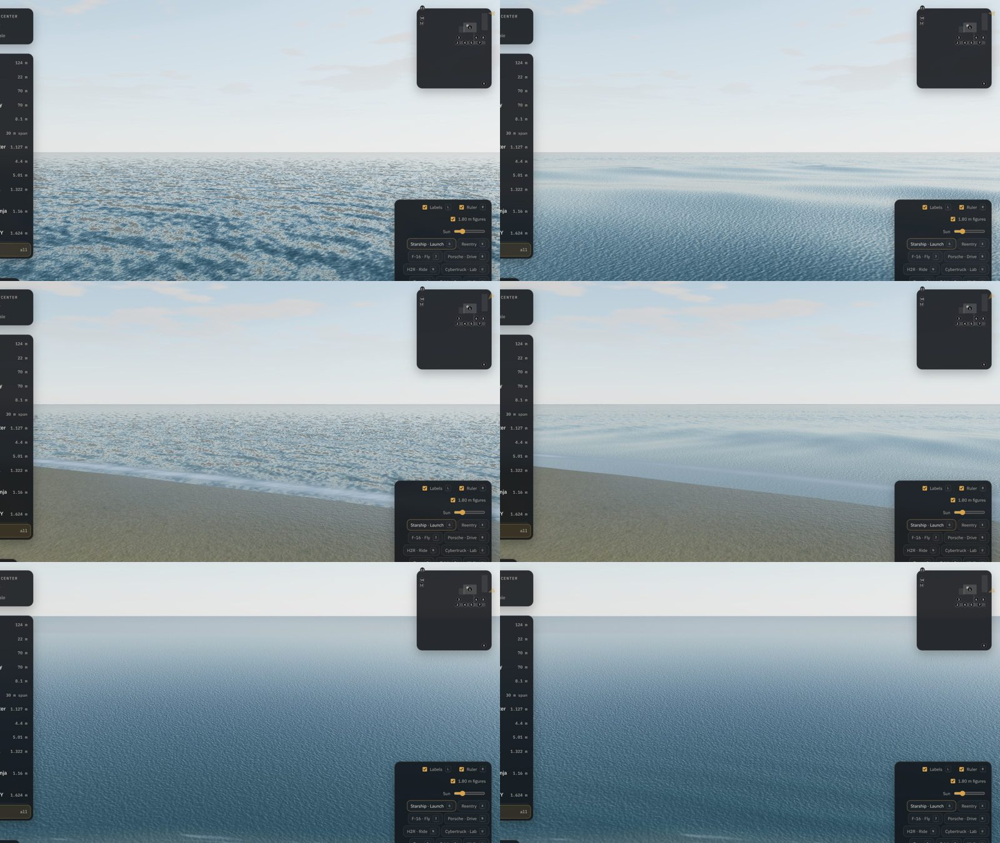

Lectura razonada, no solo diferencia de píxeles:
- **A ras (3 m):** desaparecen las motas grises y el mosaico de manchas; se ve el oleaje con
  silueta, bandas de Fresnel y la marejada cruzada con las olas de viento.
- **Orilla:** el agua tiene relieve hasta la rompiente; la lámina de la orilla sube y baja con la
  marejada. (Se suavizó después la modulación de la espuma de la orilla, que había quedado tenue.)
- **Desde el aire (220 m) y desde la plataforma (90 m):** mejora menor; sin manchas grises, pero el
  mar lejano sigue dependiendo de las capas de normales. Honestamente, el salto visible está de
  cerca y a ras.
- Revisado además con el arnés: a contraluz (sol a 14° y 40°) el reflejo solar se alarga sobre el
  oleaje sin centelleo apreciable; al atardecer (sol a 4°) se leen las crestas; sin costura en el
  borde del parche tras calcular la distancia a la costa por píxel.

**Coste:** +1 llamada de dibujo y ≈+106 000 triángulos en calidad alta (+2 % de los 5,24 M de la
vista general; 5 342 370 construidos, bajo el techo de 6 M), seis ondas por vértice en el sombreador
de vértices y dos lecturas de textura por píxel cerca del parche. **Tiempo de fotograma: no medido.**
En SwiftShader cada fotograma tarda 2–5 s y la variación entre repeticiones supera el efecto (se
intentó: activado/desactivado en tres vistas, resultados incoherentes); no se publica ninguna cifra.

**Regresiones vigiladas:** `check:static` en verde (incluye las físicas del F-16, el Porsche y la
H2R, que leen el agua); `tools/check.mjs` (escena completa con navegador) en verde con los bloques 1–2b: 5 355 967
triángulos construidos y 4 051 791 dibujados en la vista general, 1 837 mallas, 373 materiales y
172 texturas.

**Limitaciones conocidas:** sin refracción ni acortamiento de las olas en aguas someras; la costa
muestreada se fija pasados ±12 km a lo largo de la playa; la malla lejana pierde las olas cortas
(compensado con las capas de normales); los borreguillos son una aproximación por altura de cresta;
no hay salpicaduras ni ondas generadas por impactos (pendiente, enlazable con `effects.js`).

## 6. P0 de la misión del vuelo 14: lo que se ha podido comprobar (sin cambios en el código)

`src/sim/mission.js` encadena: apagado del ascenso (T+8:11) → vuelo libre kepleriano → encendido de
desorbitación (T+8:52:37–8:52:48, «cited») → interfaz de entrada a 120 km, con `payload: 0` y sin
inserción orbital. Es coherente por dentro, pero no es la misión entera.

Fuentes consultadas el 8-11-2026:
- **spacex.com/launches/starship-flight-14** (primaria): la página se genera con JavaScript y la
  lectura automática solo devuelve el título. **No verificada en esta sesión**; hay que leerla en
  un navegador.
- Secundarias (prensa, 28–29-9-2026; coinciden): Starship llegó a órbita y desplegó **26 Starlink V3**
  con su dispensador; SpaceX dijo haber contactado con los 26. Un motor de la etapa se apagó antes de
  tiempo en el ascenso; la **inserción orbital la hizo un solo Raptor de nivel del mar** (el encargo
  la sitúa entre T+00:25:17 y T+00:25:36, ≈19 s, cifra que la búsqueda solo encontró en una vista
  previa). SpaceX acortó el vuelo y no completó todas las órbitas previstas.
- **Discrepancia sin resolver:** un blog que cita a Jonathan McDowell pone la desorbitación a las
  2 h 12 min (dos órbitas); `mission.js` tiene T+8:52:37 «citado». Una de las dos no corresponde al
  vuelo real (o el código cita la previsión y no lo ocurrido). **Hay que resolverlo con la fuente
  primaria antes de tocar nada**: es exactamente el tipo de error que el encargo pide no introducir.

Plan propuesto (pendiente de la verificación anterior): separar en `mission.js` un modo **histórico**
(eventos documentados: apagado, vuelo libre suborbital, inserción con un Raptor y su Δv por la
ecuación del cohete con masa e Isp ≈, despliegue de 26 × masa de un V3 — dato a buscar, ≈ si no se
publica —, órbita resultante, desorbitación real) y uno **hipotético** (el actual), etiquetados en la
interfaz; y ampliar `tools/mission-check.mjs` con continuidad de estado en cada costura, conservación
de energía en vuelo libre, contabilidad de masas y convergencia con el paso, sin usar como
«validación» los mismos puntos con los que se ajusta.

Fuentes secundarias: [Payload](https://payloadspace.com/starship-reaches-orbit-on-14th-test-flight/),
[SpacePolicyOnline](https://spacepolicyonline.com/news/starship-achieves-orbit-for-the-first-time/),
[Aerospace America](https://aerospaceamerica.aiaa.org/spacex-shortens-starships-first-orbital-flight-but-achieves-other-objectives/),
[Basenor (cita a J. McDowell; menos fiable)](https://www.basenor.com/blogs/news/starship-flight-14-reaches-orbit-then-returns-early-after-1-orbit).

## 7. Bloque 2a: el suelo de la sonda de reflejos (hecho; efecto pequeño)

**Problema (confirmado, A4):** la mitad inferior de la sonda de entorno era un disco gris uniforme
hasta el horizonte: ningún metal, pintura o cristal reflejaba el Golfo al este ni la marisma y la
playa alrededor.

**Hecho:** `environment.js probeGround()`: el disco lleva, vértice a vértice, lo que hay en esa
dirección visto desde 6 m sobre el centro de la fila de expositores: el gris del recinto hasta
≈150 m (el mismo 0,30 de antes), después los albedos del propio sombreador del terreno (hierba y
paja de la llanura, matorral, arena seca y mojada) por las mismas funciones que los colocan, y el mar.
Radiancia = albedo × 1,35, la proporción que el gris anterior suponía. ≈: un solo punto de vista
para todo el recinto y el mar «como se ve en rasante». Interruptor de comparación en consola:
`__vc.env.setProbeGround('flat')` / `'site'`. Prueba sin navegador `tools/probe-check.mjs` (en
`check:static`): el mar al este, tierra al oeste, el gris junto a la fila, colores finitos.

**Validación visual (misma sesión, misma cámara, solo cambia la sonda):** en el acero de Starship
(vista *lee*) y en el costado del Porsche la diferencia es **apenas perceptible**: esas superficies
reflejan sobre todo la franja del horizonte, que no cambia. Es una corrección de coherencia, sin
coste por fotograma (la sonda se rehace solo al cambiar el sol), no el salto visual que pide el
encargo.

**2b (hecho después, §8).** Propuesta original: sondas locales capturadas de la escena real (`CubeCamera` + PMREM,
solo al cambiar el sol y sin el propio vehículo), empezando por Starship junto a la torre, con sus
materiales propios apuntando a esa sonda. Riesgos a medir: materiales compartidos entre vehículos
(clonarlos sube la cuenta, hoy 363 de 420), el coste de seis pasadas de la escena por cambio de sol
(en el arrastre del deslizador habría que diferirlas a cuando se suelta) y las pruebas que comparan
luminancias.

## 8. Bloque 2b: sonda de reflejos local para Starship (hecho; efecto moderado)

**Problema:** el acero casi especular de Starship está a ≈30 m de la torre y reflejaba el cielo
abierto donde está la celosía, y nada de la plataforma.

**Decisión:** `src/core/localProbes.js`, genérico: una captura cúbica de la escena real desde un
punto (el vehículo oculto mientras tanto), prefiltrada con PMREM como la sonda común y asignada a
copias privadas de los materiales de ese vehículo (26 en Starship; presupuesto medido por `tools/check.mjs`
tras el bloque: 373 materiales, techo 420). Se rehace solo cuando se rehace la sonda común (cambio de sol, contexto
recuperado), 250 ms después de la última petición: arrastrar el sol cuesta una captura al soltarlo.
Mientras no está lista, y durante el lanzamiento y la reentrada (el vehículo ya no está allí), las
copias usan la sonda común. Comprobado en el código de three r170: con `envMap` propio el material
no recibe `scene.environmentIntensity` (atenuado de noche y altura), que se copia a mano cada
fotograma, y `clone()` no copia `onBeforeCompile` ni `customProgramCacheKey`, que se copian.
Punto de captura: el eje de la pila, a 45 m sobre su base (≈: una sola sonda para 124 m de
vehículo; las partes bajas tienen algo de paralaje).

**Validación visual (misma sesión y cámara, vista *lee*, esperando a que el cambio se aplique):**
con la sonda local el casco gana contraste y su borde iluminado deja de quemarse, porque el lado de
la torre refleja estructura y suelo en lugar de cielo claro; la celosía no se distingue como forma
(la rugosidad del acero la difumina en el PMREM). Diferencia media del encuadre ≈1/255: cambio
**real pero moderado**. Consola: `__vc.localProbes.probes[0].active = () => false` para comparar.

**Coste:** seis pasadas de la escena a 256² por cambio de sol (no por fotograma) y un PMREM. No
medido en hardware real.

**Pendiente:** más sondas (Falcon 9, Falcon Heavy, Porsche, Roadster) si la medición en hardware
real lo permite; en reflejos de formas nítidas (cristales, pintura con barniz) el salto sería mayor
que en el acero rugoso.

## 9. Bloque 3: nubes con volumen (hecho; pendiente de medir el coste en hardware real)

**Problema (confirmado, A3):** `clouds.js` era ruido 2D en un plano a 1 400 m dentro de una cúpula
que sigue a la cámara: sin espesor, sin sombra propia, y desvanecido al subir hacia la base porque
un plano no se puede ver desde arriba.

**Alternativas:** volumen completo con texturas 3D y reproyección temporal (lo mejor, pero exige
un pase a media resolución y acumulación entre fotogramas que el compositor actual no tiene);
**capa volumétrica marchada en la propia cúpula** (elegida: contenida en `clouds.js`, sin pases
nuevos); impostores (no se pueden atravesar).

**Hecho:** el rayo de vista se recorre por la capa de 1 400 a 2 600 m (≈) con la **misma cobertura**
que la capa plana, de modo que los dos niveles dibujan las mismas nubes. Densidad = cobertura ×
perfil vertical (base plana, cima en cúpula que sube donde la nube es más gruesa) − erosión por ruido
3D en tres escalas. Luz: Beer-Lambert, tres muestras hacia el Sol para la sombra propia, fase de
Henyey-Greenstein de dos lóbulos, efecto «powder», ambiente más claro arriba que abajo, y
perspectiva aérea por la distancia al primer impacto. Escribe la profundidad de ese impacto
(`gl_FragDepth`): desde arriba el suelo queda detrás de la nube y un avión delante de ella sigue
delante. En vuelo (`setAltitude(…, { flight: true })`) ya no se desvanece al llegar a la base; se
puede entrar, atravesar y mirar desde arriba. El lanzamiento conserva el desvanecido anterior.
Pasos por rayo según la calidad (`quality.js cloudSteps`): 32 alta, 20 media, 0 baja (la capa plana
de siempre). Consola: `__vc.env.clouds.setMode('layer' | 'volume')`.

**Validación visual (arnés, misma cámara):**
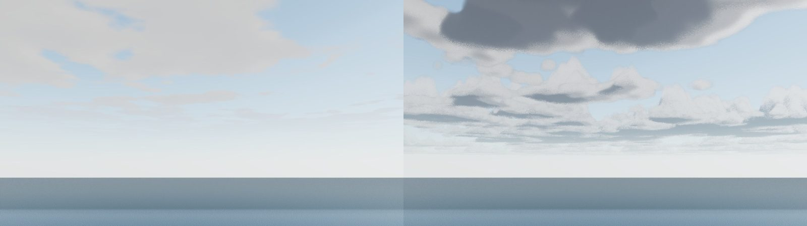
- Desde el suelo: cúmulos con cimas iluminadas, bases grises y perspectiva hasta el horizonte,
  donde antes había un velo plano.
- Desde arriba (3 500 m) y dentro de la capa (1 900 m): se ven las cimas y el mar por los huecos, y
  jirones dentro. La cámara del arnés no es la del F-16 (su plano lejano es 9 km): falta revisarlo
  en un vuelo real.
- Primeras versiones corregidas en la misma sesión: cimas en cono que se leían como montañas y luz
  solar demasiado débil desde arriba.

**Limitaciones conocidas:** grano fino estático por el desfase aleatorio de cada píxel (no hay
acumulación temporal); alguna cima aún algo aguda; el plano lejano corta lo que queda más allá.
**Coste no medido** en hardware real: 32 pasos con ruido 2D y 3D por píxel de cielo, más tres de luz
donde hay nube. Si en la RTX 3070 del usuario no cabe, la vía es bajar los pasos del nivel alto o
pasar a media resolución con reproyección; el nivel bajo no cambia.

**Correcciones tras el check completo (misma sesión):**
- **Defecto del bloque 2b encontrado por `check:cache`** («el Sol sube a 55°: mapa de sombras
  idéntico», 87 886 bytes distintos): la captura de la sonda local renderiza la escena con Starship
  oculto, y si el mapa de sombras se redibujaba en ese momento quedaba guardado sin su sombra hasta
  la siguiente invalidación. Ahora la captura congela el mapa de sombras (`autoUpdate` y
  `needsUpdate` guardados y restaurados). `check:cache` vuelve a verde.
- **Escena e interfaz agotaban el tiempo** con las nubes nuevas, incluso con 6 pasos: con un bucle de
  longitud constante, SwiftShader desenrollaba el marcado completo y tardaba minutos en compilar el
  sombreador al cargar. Ahora los pasos son un uniforme (`uSteps`, bucle dinámico de GLSL ES 3.0):
  no se desenrolla y se pueden cambiar en vivo (`__vc.env.clouds.steps = 16`), lo que deja la puerta
  abierta a una calidad adaptativa sin recompilar. Bajo automatización (`navigator.webdriver`) se
  usan 6 pasos salvo `?clouds=full`, para que las pruebas sigan dibujando el volumen sin minutos por
  fotograma. Con esto `tools/check.mjs` y `tools/ux-check.mjs` pasan (escena 8 min 45 s, interfaz
  33 min en este contenedor).
- Check completo en verde por partes: estáticas, escena, interfaz, LOD, cachés y Cybertruck Lab.

**Revisión en un vuelo real del F-16 (misma sesión):** con el avión colocado a 3 300 m (sobre la capa)
y a 2 000 m (dentro), su cámara de persecución y su plano lejano (≈270–330 km):
- con los 6 pasos de la automatización, grano muy fuerte; con los 32 del nivel alto
  (`__vc.env.clouds.steps = 32`), masas de nube reales, el suelo entre ellas y jirones al
  atravesarlas;
- desde arriba, las cimas aún se leían como picos nevados: el perfil pasa a cúpula
  (`sqrt` del grosor) y la sombra propia pesa más (pliegues más marcados). Queda alguna cima aguda y
  el grano estático del muestreo.

## 10. Tierra orbital (P2): bloqueado

`backdrop.js` pinta una Tierra procedural «deliberadamente genérica» (lo dice su cabecera). La
sustitución prevista es el mosaico Blue Marble Next Generation de la NASA (dominio público; se
puede incluir en el repositorio sin chocar con la regla de fotos con derechos), reducido a
2048 × 1024 y comprimido. **Bloqueado el 8-11-2026:** `eoimages.gsfc.nasa.gov` corta la conexión
desde este contenedor (dos intentos normales; la red del entorno no tiene restricciones, así que es
el servidor). No se ha sustituido por ninguna otra fuente sin verificar su procedencia. Para
retomarlo basta con el archivo `world.topo.200412.3x5400x2700.jpg` del registro 74142 de NASA
Visible Earth, descargado desde otra máquina.

## 11. P0 del vuelo 14: corregido lo que la interfaz presentaba como hecho

**Problema (confirmado, grave):** el capítulo de la reentrada decía «Every time on this clock is
SpaceX's own» y, al terminar, «Flight 14's ship splashed down on target in the northern Pacific,
nine hours and fifty minutes after liftoff». Ese es el **plan previo al vuelo**. El vuelo real se
acortó tras fallar un Raptor Vacuum en el ascenso: desorbitación a T+2:12:00–2:12:11 y amerizaje
al norte de Hawái unas tres horas después del despegue ([Wikipedia, «Starship flight 14»](https://en.wikipedia.org/wiki/Starship_flight_14);
[Space.com](https://www.space.com/news/live/spacex-starship-flight-14-live-updates-sept-28-2026-starship-first-orbital-launch-attempt);
[CNN](https://www.cnn.com/2026/09/28/science/live-news/spacex-starship-flight-14-launch)). Era una
reconstrucción hipotética presentada como histórica, lo que el encargo prohíbe expresamente.

**Datos del vuelo real usados** (Wikipedia, con referencias a SpaceX): inserción T+25:17–25:36 en
spacex.com y T+25:28–25:47 en Wikipedia (se dan las dos); 26 Starlink V3 liberados entre T+34:18 y
T+1:04:50; órbita de 262 × 275 km a 30,5°. **No se usan** los tiempos posteriores a la
desorbitación: el encendido de aterrizaje aparece exactamente 7 h antes del planificado y el
amerizaje (T+3:08:30) 18 min después de él, lo que no encaja.

**Hecho:** la nota del capítulo y el aviso final dicen ahora que el capítulo vuela el **plan** y
resumen lo ocurrido; la ficha de Starship tiene una fila nueva, «Flight 14 · as flown», con fuente
propia (`wiki_ft14`), y la fila de la reentrada pasa a «planned timeline»; los comentarios de
`reentryFlight.js` y `mission.js` dicen lo mismo. La procedencia (`provenance-check`) y
`mission-check` siguen en verde.

**Pendiente:** un modo histórico que vuele el perfil real (inserción con un Raptor, despliegue de 26
satélites con su masa —no publicada: ≈—, la órbita de 262 × 275 km, desorbitación a T+2:12). Los
tiempos de entrada y aterrizaje del vuelo real no están bien establecidos en las fuentes leídas.

## 12. Calidad adaptativa (§34) y modo fotográfico (§27)

**Calidad adaptativa (hecho; la lógica verificada, el efecto pendiente de medir en hardware real).**
`src/core/adaptive.js`: el percentil 95 de los últimos 90 intervalos de fotograma frente a un
presupuesto de ≈18 ms (55 fps). Baja un nivel si el p95 pasa de 1,2 × presupuesto durante 3 s;
sube uno tras 12 s por debajo de 0,8 × presupuesto; cada subida que trae de vuelta los fotogramas
lentos duplica la espera siguiente (hasta 5 min), para que se asiente en vez de oscilar; ignora
intervalos de más de 250 ms (pestaña en segundo plano, paradas). Hoy solo actúa sobre los pasos por
rayo de las nubes (32 → 24 → 16 → 10 en calidad alta), que se cambian sin recompilar: nunca sobre
la geometría ni el detalle cercano, ni sobre el nivel de calidad entero. Desactivada bajo
automatización y con `?adaptive=off`; estado en `__vc.adaptive.state`. Prueba sin navegador
`tools/adaptive-check.mjs` (en `check:static`) con secuencias inventadas: 60 fps estables no
cambian nada; picos aislados de 200 ms tampoco; carga sostenida baja hasta que los fotogramas
caben, un paso cada 3 s como mucho; vuelve a subir cuando hay margen; y en el caso trampa (el nivel
alto no cabe, el siguiente sí) los intentos de subida quedan a 16, 44, 95, 195 y 391 s.

**Modo fotográfico (hecho).** Tecla **O** (`src/ui/photoMode.js`): campo de visión (solo en las
cámaras libres), compensación de exposición ±2 EV (`environment.js setExposureBias`), altura y
rumbo del Sol, ocultar la interfaz y *Save PNG* del fotograma recién dibujado (el bucle lo entrega en
la misma tarea en que lo dibuja: sin `preserveDrawingBuffer` no hay otra forma). *Reset*, *Close* y
**Esc** devuelven los valores exactos que había al abrirlo. Sin profundidad de campo ni desenfoque.
Prueba con navegador en `tools/ux-check.mjs` (tres comprobaciones: los controles mandan, el PNG
tiene contenido, la vuelta es exacta).

**`tools/shot.mjs`:** las nubes completas solo con `--clouds-full` (para generar la galería en una
máquina con GPU); por software cada fotograma tardaba minutos.

## 13. Sonido (§26): volumen general y ambiente de la costa

**Estado comprobado:** el sonido de los motores ya es espacial y físico (retardo d/c con Doppler
exacto, HRTF, dispersión esférica y filtrado por el aire: `audioBus.js`), pero no había volumen
general ni ambiente: sin un motor encendido, el centro era mudo.

**Hecho:**
- Volumen general en el bus maestro (`audioBus.js setVolume`, como su cuadrado para que el recorrido
  suene uniforme), guardado entre visitas, en la guía (**H**).
- Ambiente procedural (`src/sim/ambience.js`, sin grabaciones): la **rompiente** (ruido marrón)
  crece con cada cresta de la marejada larga —la misma fase que mueve la espuma de la orilla, así
  que lo que se oye romper es lo que se ve romper—, cae con la distancia a la línea de agua (≈1/d
  pasados 30 m) y se apaga al subir; el **viento** (ruido rosa) sigue la velocidad del viento del
  sitio a la altura de la cámara (`wind.js`, con rachas). Callado en el espacio, en la vista orbital y
  mientras un vehículo pone su propio sonido. Casilla en la guía, recordada entre visitas (empieza
  tras el primer clic, como exigen los navegadores).
- Prueba sin navegador `tools/ambience-check.mjs` (en `check:static`): la rompiente máxima en la
  orilla, ≈0,10 a 300 m y ≈0,03 a 1 km, con cada cresta de 0,45 a 1; el viento mudo en calma, un
  susurro a los 6,2 m/s del sitio (0,12) y saturado en un temporal.

**Reverberación contextual (hecha después, misma sesión):** un envío del bus maestro por un
convolvedor (`audioBus.js`) con una respuesta al impulso generada por código: tres ecos discretos
(≈90, 170 y 260 ms: las caras de la torre y los muros del pad, ≈) y una cola corta (RT60 ≈0,9 s),
no una sala. Se mezcla por la distancia de la cámara a la plataforma: entera junto a ella, 0,84 a
100 m, 0,39 a 300 m, nada pasados ≈600 m. Lo que más lo nota es el lanzamiento oído desde cerca.
Prueba en `tools/ambience-check.mjs`: la cola cae 50 dB en un segundo, el primer eco destaca y la
mezcla decrece con la distancia.

**Pendiente:** sonidos de mecanismos (brazos de la torre, pinzas). Los niveles relativos están
ajustados de oído, ≈.

## 14. ¿WebGPU? (§35): estudio, sin migración

Medido en el código el 8-11-2026 (three r170 en `vendor/`):

| Lo que habría que rehacer | Cuánto |
|---|---|
| Parches `onBeforeCompile` sobre los fragmentos GLSL de three (no existen en `WebGPURenderer`: hay que reescribirlos como materiales de nodos en TSL) | 17, en 8 archivos (`library.js`, `environment.js`, `detail.js`, `campus.js`, `common.js`, `h2r/index.js`, `gt3Drive.js`, `localProbes.js`) |
| `ShaderMaterial` en GLSL (también a TSL) | 19, en 7 archivos; el grueso en `plume.js` (9) y `reentry.js` (4), más nubes, efectos, fondo orbital y oclusión |
| Posprocesado sobre `EffectComposer` (RenderPass, GTAO propio, bloom, recorte de luciérnagas, salida) | 1 cadena en el centro y 1 en el Cybertruck Lab, a pasar al sistema de posprocesado de nodos |
| Cachés de sombras y de G-buffer (`shadowCache.js`, `gbufferCache.js`), atadas a detalles de `WebGLRenderer` (`shadowMap.autoUpdate`, destinos de dibujo) | 2 módulos y su prueba byte a byte |
| La compilación WebGPU de three | no está en `vendor/` (solo `three.module.js`): habría que añadir `three.webgpu.js` y comprobar sus dependencias |

**Beneficio: no medible aquí.** El contenedor no tiene GPU; un WebGPU por software no dice nada
de un equipo real. **Recomendación: no migrar ahora.** El coste es reescribir prácticamente todos
los sombreadores del proyecto y su posprocesado, con riesgo directo sobre las pruebas de imagen; la
ganancia esperable (menos sobrecarga de CPU por llamada de dibujo, *compute* para partículas) solo
justifica el cambio si las mediciones en hardware real (`?perf=log`, tecla **I**) muestran que el
cuello de botella es la CPU por llamadas de dibujo. Paso previo razonable y barato: una página
aislada con `WebGPURenderer` y una escena de prueba (el mar y el cielo) para medir en el equipo del
usuario, sin tocar el centro.

## 15. Nube de suelo (§13): un intento descartado, y por qué

**Problema (confirmado en las capturas):** la nube del despegue se lee como bolas redondeadas
superpuestas. Cada bocanada es un *billboard* del atlas de 16 «coliflores» (`plume.js
buildPuffTexture`) con su propio sombreado de cúpula.

**Intento (8-11):** erosionar todas las bocanadas con un mismo campo de turbulencia 3D en el espacio
del mundo, que hierve hacia arriba con un reloj propio de la nube (reproducible por `seek`), para que
los bordes de las vecinas se fundieran; más tarde, deshilachar el contorno de cada lóbulo, suavizar
su sombra esférica y ampliar el contraste del ruido. Comparado en el arnés en la misma sesión,
cámara e instante (T+1,5 s, calidad media), con un interruptor (`uTurb` 0/1).

**Resultado:** tres versiones, diferencia apenas perceptible: los contornos siguen redondos. A la
distancia de las vistas del lanzamiento (≈400 m) el detalle de 3,5 m cae bajo el píxel y se
promedia, y las escalas de 24 m varían poco dentro de una bocanada de 30–40 m. El aspecto de bolas
viene del propio atlas, no de su recorte. **Descartado**, sin commit: no se presenta como mejora algo
que no se ve.

**La vía que sí lo resolvería (pendiente, coste alto):** cambiar las bocanadas por un volumen de
densidad marchado (como las nubes, §9) o, más barato, un atlas nuevo de formas irregulares (no
cúpulas) con varias escalas de lóbulos por bocanada y bocanadas más pequeñas y numerosas en los
bordes de la masa, que es donde el ojo lee la silueta.

**Segunda vía, hecha (8-11):** el atlas. La masa principal de cada bocanada era una sola cúpula de
radio 0,36, y a unos cientos de metros, donde las torrecillas pequeñas caen bajo el píxel, era lo
único que quedaba de cada una: una bola. Ahora es un racimo asimétrico de 3–4 cúpulas medianas
(radio 0,19–0,31) con los lóbulos intermedios repartidos entre ellas, y el relieve se aplana a 0,6
para el sombreado (un casquete esférico completo sombreaba cada lóbulo como una esfera). Mismo
número de bocanadas, misma textura compartida (la nube de suelo y el vapor), mismo coste.

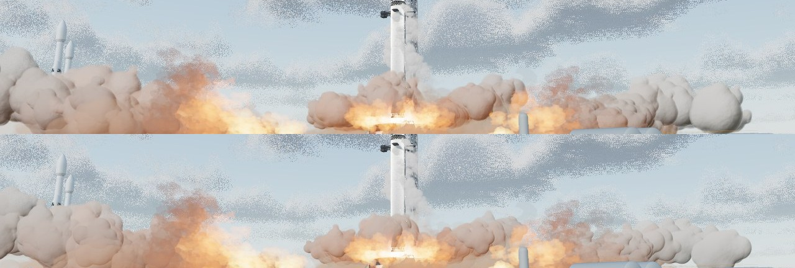

Resultado: la masa se lee como un cúmulo continuo de muchos lóbulos y no como bolas sueltas (la
«bola» de la derecha es ahora un racimo); sigue siendo algo grumosa. El volumen marchado sigue
siendo la mejora de fondo pendiente.

## 16. Reentrada (§15): la estela de plasma acababa en dos rectas (error de normales, corregido)

**Problema:** en las vistas de la reentrada, la estela de plasma era una cuña morada con dos bordes
rectos y nítidos contra el cielo y la Tierra. **Causa:** su cono está escalado de forma muy
desigual (decenas de metros de ancho, kilómetros de largo) y el sombreador de vértices transformaba
las normales con `mat3(modelMatrix)`: con escala no uniforme eso las inclina hacia el eje, la
silueta nunca quedaba de canto y el brillo llegaba entero hasta el borde. La envoltura de plasma
tenía el mismo error, leve (escala 1,25 × 1 × 1,05).

**Hecho (`reentry.js`):** la estela usa la matriz de normales en espacio de vista; la envoltura, la
inversa transpuesta en el espacio del mundo (donde está el flujo). Además, la silueta de la estela
la empujan remolinos que bajan con el flujo, la turbulencia tiene dos escalas y el brillo cae de
forma exponencial detrás de la nave. No hay más casos del patrón en el código.

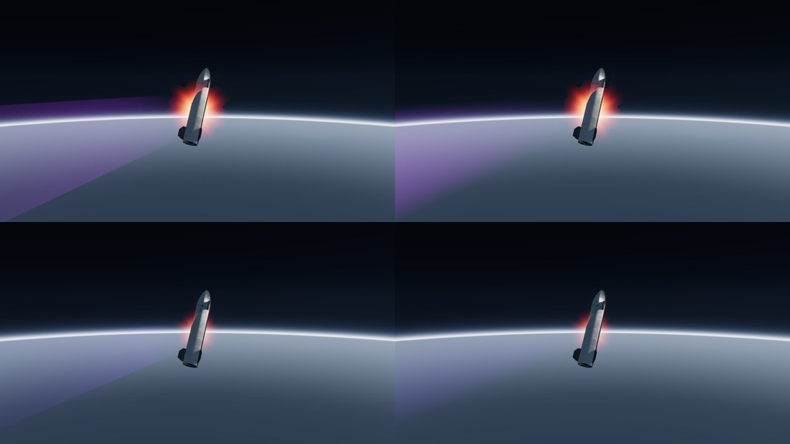

**Pendiente:** el plasma de la envoltura sigue siendo un halo sin volumen; el calentamiento por
regiones (bordes de las aletas, morro) y la Tierra genérica (§10, bloqueada) quedan para después.

**Calentamiento por regiones (probado y descartado, 8-11):** más brillo en el morro y en los bordes
de las aletas, por la geometría de la envoltura. En las vistas de persecución y a bordo la
diferencia no se aprecia: domina el halo, que desde detrás se lee como un estallido rojo de bordes
en pico (el ruido de parpadeo en la silueta de una cápsula aditiva). Sin commit. La mejora de fondo
es sustituir ese halo por un volumen de plasma pegado a la cara de barlovento (marchado, como las
nubes), con la emisión de cada región; pendiente.

**El halo en estallido (corregido, 8-11):** después de dos intentos sin efecto sobre la envoltura,
el origen resultó ser otro: el halo de la reentrada es el `Glow` de la bola de la separación en
caliente (`plume.js`), reutilizado, cuyo borde lleva a propósito lóbulos senoidales de 7 y 13
picos («the ball boils»). Detrás de la nave dibujaban un estallido rojo. `Glow` acepta ahora una
irregularidad (`ragged`): la separación conserva la suya (1); la reentrada, 0, un resplandor suave.

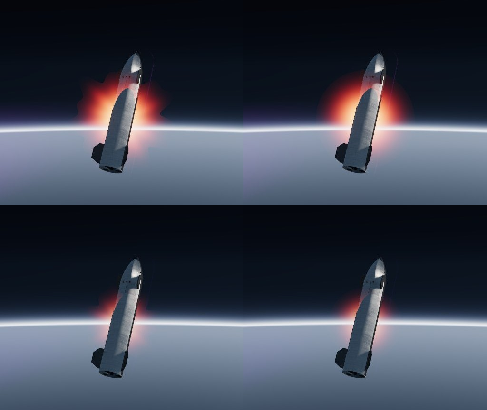

## 17. Sonda local para la explanada de la pista (Porsche, H2R, Model Y)

**Problema:** el barniz del Porsche (1, rugosidad 0,06) es casi un espejo, pero con la sonda común
reflejaba cielo y bruma hasta los faldones: la carrocería se veía plana y sin suelo debajo.

**Hecho:** `localProbes.js` acepta varios objetos por sonda (una sola captura, todos ocultos
mientras se toma). Los tres vehículos de la explanada, a menos de 5 m entre sí, comparten una a la
altura de la cintura del Porsche (150 materiales copiados); se desactiva mientras se conduce el
Porsche o la H2R.

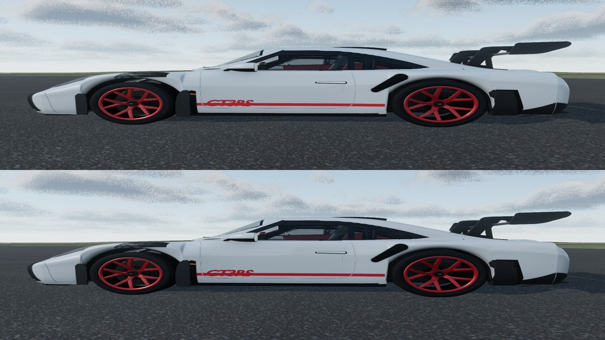

**Resultado:** los bajos del costado y los faldones reflejan el asfalto oscuro que tienen debajo;
las superficies altas casi no cambian. Moderado, correcto y sin coste por fotograma (una captura
más por cambio de sol).

## 18. Auditoría de materiales por familias (§10), sobre los datos reales

Extraída del centro en marcha (`__vc.M`, 163 materiales de la biblioteca y de los vehículos), no de memoria. Columnas: cuántos, cuántos con mapas propios (color, normales, rugosidad o metal), y el intervalo de metalicidad y rugosidad base (los mapas la modulan).

| Familia | Materiales | Con mapas | Metalicidad | Rugosidad base | Con barniz |
|---|---|---|---|---|---|
| Metales | 49 | 17 | 0.50–1.00 | 0.12–1.00 | 3 |
| Pinturas y barnices | 20 | 16 | 0.00–0.35 | 0.12–1.00 | 19 |
| Vidrio y lentes | 7 | 1 | 0.00–1.00 | 0.02–0.18 | 3 |
| Caucho y plásticos | 17 | 6 | 0.00–0.35 | 0.22–0.95 | 2 |
| Cerámica y protección térmica | 6 | 3 | 0.00–0.70 | 0.55–1.00 | 0 |
| Suelo, hormigón y asfalto | 10 | 6 | 0.00–0.00 | 0.66–1.00 | 0 |
| Otros | 54 | 12 | 0.00–0.45 | 0.12–1.00 | 0 |

**Observaciones verificadas:**
- Los aceros de Starship y del Super Heavy (7) comparten un mapa de color, normales y rugosidad con variación por chapa (anillos y placas con tono y brillo propios), rugosidad base 0,86 modulada: es la familia mejor resuelta.
- Las pinturas del Falcon y de Dragon son físicas con barniz fino (0,16–0,30) sobre mapas de color y rugosidad; la del Porsche, barniz 1 con rugosidad 0,06 (casi espejo) y oclusión horneada; desde el §17 refleja su entorno.
- `gt3Carbon` (carbono exterior del Porsche, liso, sin trama ni barniz) **no lo usa ninguna pieza**: material muerto, sin efecto visible. El carbono del habitáculo sí lleva la trama barnizada de la biblioteca.
- La mayoría de materiales pequeños (motores, tren, piezas del pad) son de valor constante sin mapas: correcto a la distancia a la que se ven; su microdetalle procede de `detail.js` (mapa de detalle por escala) donde está aplicado.
- **Pendiente:** fotografía virtual del mismo objeto bajo tres soles (mañana, mediodía, atardecer) por familia, como pide el encargo; con el modo fotográfico (tecla **O**) es reproducible, pero cada captura por software tarda minutos.

## 19. Animación secundaria (§28): la hierba de las dunas se mueve con el viento del sitio

**Antes:** toda la vegetación era estática.

**Hecho:** las matas de las dunas (`library.js duneGrass`) se doblan a favor del viento en el
sombreador de vértices, por el cuadrado de la altura de cada brizna (la raíz no se mueve), más en
una racha y menos en una calma, con un leve temblor. Las rachas son **el mismo campo** que mueve la
manga y que sienten el F-16, el Porsche y la H2R: `wind.js gustGLSL()` genera el GLSL desde la
misma tabla de ondas de su turbulencia congelada, que avanza con el viento medio, así que una
racha cruza las dunas a la velocidad del viento y en su dirección. ≈12 cm en la punta de una mata de
0,9 m con la brisa media (ajustado a ojo). Sin coste de CPU; unas pocas operaciones por vértice.

**Comprobado en el arnés:** compila, las 46 tandas de hierba se dibujan, y entre dos fotogramas
separados 3 s solo cambian las puntas de las matas (82 píxeles con diferencia > 20 en un encuadre
cercano; el resto de la imagen, quieta).

**Pendiente:** el matorral y los arbustos del recinto (otros materiales) siguen estáticos.

## 20. Carga inicial (§31): dónde se va el arranque (medido)

Tiempos de CPU del arranque (`__vc.timings`, contenedor de 4 núcleos, sin GPU; la caché de texturas
está desactivada bajo automatización, así que es una **primera visita**):

| Fase | ms |
|---|---|
| Generar los materiales (texturas procedurales) | 5 921 |
| Roadster | 1 515 |
| Porsche 911 GT3 RS | 1 083 |
| F-16A | 736 |
| Tesla Model Y | 276 |
| Starship | 185 |
| H2R, Dragon, Engine Row, Falcon Heavy, Falcon 1, Falcon 9, Starlink | 148 · 100 · 94 · 87 · 49 · 45 · 17 |

La compilación y el primer fotograma (≈21 s aquí) son render por software y no se pueden extrapolar.
**Lectura:** el coste dominante de una primera visita es la generación de texturas; la caché de
texturas entre visitas (fusionada hoy, `fcabaf6`) lo elimina a partir de la segunda. Lo siguiente
con sentido sería medir en el equipo del usuario con `?perf=log` y la tecla **I**; el traslado de
las texturas a un hilo de trabajo ya se estudió y se descartó el 17-10 (ver `docs/rondas/`).

## 21. Sombras de las nubes sobre el paisaje (§6), coherentes con las nubes dibujadas

**Hecho (`clouds.js applyShadow`, aplicado por `environment.js` a la biblioteca, al mar y, tras
construirlos, a los materiales de los vehículos: 1 890 de 1 946):** cada punto iluminado sigue su
rayo hacia el Sol hasta la capa (≈1,7 km) y mira la cobertura allí, la **misma función con las
mismas cuatro octavas** que dibuja las nubes, de modo que cada sombra cae bajo su nube. Bajo una
nube gruesa quita ≈85 % de la luz directa y 15 % de la difusa del cielo. Solo con las nubes de
volumen (calidad alta y media) y mientras se ven; se desvanece con ellas. Desactivadas bajo
automatización salvo `?clouds=full` (alargaban la compilación por software de ≈160 programas). Consola:
`__vc.env.clouds.shadows = false`.

**Depuración honesta:** la primera versión no se veía. Se midió por qué: con tres octavas la
cobertura de la sombra cubría el 38 % del cielo frente al 51 % de las nubes, y la rampa elegida
solo oscurecía de verdad un 2 % del área; además el interruptor de comparación no restauraba el
valor. Con todo corregido, a cobertura casi total el suelo baja un 15 % de luminancia (en esta
escena la luz ambiental pesa mucho frente al sol), y en la vista amplia las sombras se ven como
manchas grandes y suaves.

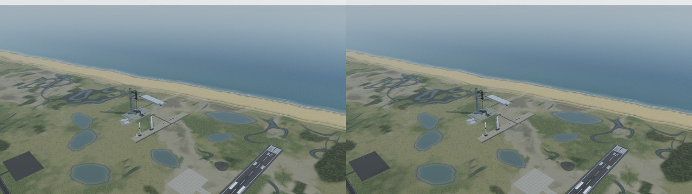

**Coste:** el ruido de cobertura (dos fbm de cuatro octavas) en cada píxel iluminado: no medido en
hardware real.

## 22. Refactorización (§36), primer paso

El panel técnico (tecla **I**), `?perf` y `?perf=log` salen de `main.js` a `src/ui/techPanel.js`
sin cambiar su código (sus dependencias pasan por parámetro): `main.js` baja de ≈1 810 a 1 722
líneas. Verificado en el navegador: la tecla **I** abre y cierra el panel y muestra sus dos líneas.
Los archivos grandes restantes (`launch.js`, `plume.js`, `roadster.js`, `gt3rs.js`, `textures.js`)
no se tocan sin una prueba que cubra cada pieza extraída.

## 23. Model Y: nivel de detalle por sustitución de los neumáticos (P2, hecho)

**Problema (medido):** los cuatro neumáticos de Blender tienen 142 016 triángulos cada uno:
568 064 de los 1 208 054 del coche (47 %) y ≈11 % de la escena, dibujados a cualquier distancia.

**Hecho (`src/vehicles/latheLod.js`, enganchado en `modelyAsset.js`):** pasados 25 m, cada
neumático cede a un sólido de revolución de **su propio contorno**, medido sobre la malla (el radio
máximo y mínimo en 40 franjas a lo largo del eje): 11 952 triángulos. Un `THREE.LOD` por rueda; un
solo material lejano compartido por las cuatro (el cercano sin sus mapas, que el torno no puede
leer). Ahorro: ≈520 000 triángulos con el coche a más de 25 m, que es casi siempre (la vista general,
las demás exhibiciones, el vuelo).

**Validación:** forzando la versión lejana a ≈15 m (más cerca que el umbral), las ruedas se ven
iguales: diferencia media 0,43/255 y ningún píxel por encima de 25 en el recorte. A 25 m el cambio
es invisible.

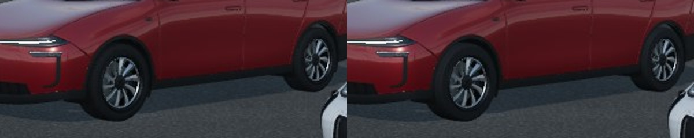

**Medido por `tools/check.mjs`** (presupuesto de la vista general): 3 531 535 triángulos dibujados,
frente a 4 051 791 antes del cambio: **520 256 menos**, lo previsto. Construidos 5 403 775 (las
copias lejanas se suman a las cercanas), 375 materiales (+1, el lejano compartido), techos sin tocar.
(Una primera ejecución local falló una espera de 30 s por tiempo del render por software; repetida,
pasa entera.)

## 24. Vuelo 14: una validación independiente que falla (P0, documentado)

**La prueba:** con el estado y la masa del apagado que integra el propio modelo (T+8:11: 200,0 km,
7 783 m/s, γ = 0°, 269,6 t), propagar el vuelo libre hasta la inserción real (T+25:17–25:36) y
aplicar ese encendido de 19 s con un Raptor de nivel del mar (250 tf, Isp ≈ 350 s: Δv ≈ 177 m/s,
13,6 t de propelente, por la ecuación del cohete), y comparar la órbita resultante con la
publicada (262 × 275 km). **Nada del modelo se ajustó a esa cifra.**

**Resultado:** 200 × 835 km. No cuadra. **Causa:** el ascenso del modelo termina, por hipótesis
(«assumed circular 200 km orbit»), ya en órbita circular, y un vuelo así no necesitaría inserción.

**Lo que sí sería coherente (calculado, ≈):** para acabar en 262 × 275 km tras un Δv prograde de
≈177 m/s, la trayectoria anterior tenía que ser **suborbital**: apogeo ≈265–275 km y perigeo
≈300 km **bajo la superficie** (periodo de la elipse ≈84 min), sea cual sea el punto de la órbita
final donde caiga el encendido. Es el perfil habitual de Starship: suborbital hasta la inserción.

**Consecuencia y pendiente:** un modo histórico fiel necesita rehacer el estado del apagado (tablas
del ascenso en `launch.js`, ahora ajustadas a la hipótesis circular) hacia esa trayectoria
suborbital, encadenar la inserción, el despliegue de los 26 satélites (masa no publicada: ≈, como
parámetro con su intervalo) y la desorbitación real a T+2:12, con pruebas de continuidad, energía y
masas en `mission-check`. No se ha hecho todavía: toca el ascenso, que alimenta el lanzamiento, la
recuperación y la reentrada, y merece una ronda propia con sus capturas. El script del cálculo es
de una sola vez (no se guarda en el repositorio); sus cifras están aquí.

**Tercera sonda local, el Roadster (8-11):** a 0,8 m sobre su peana (28 materiales copiados);
desactivada en su vista orbital. Los bajos de la pintura roja reflejan la peana oscura y el capó
gana variación; diferencia media del encuadre ≈1/255, concentrada en el coche.

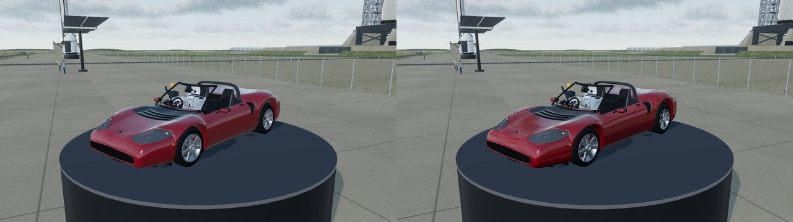

**Tercera vía, hecha (8-11): bocanadas de borde.** Un 35 % de las bocanadas emitidas son del
borde de la masa: 0,5–0,7 veces el tamaño y algo más dispersas hacia los lados y arriba. La silueta
que lee el ojo queda hecha de lóbulos a varias escalas (la gran bola del extremo derecho se deshace
en lóbulos menores que se desprenden). Mismo número de bocanadas; al ser menores, menos relleno.
Pequeño pero visible.

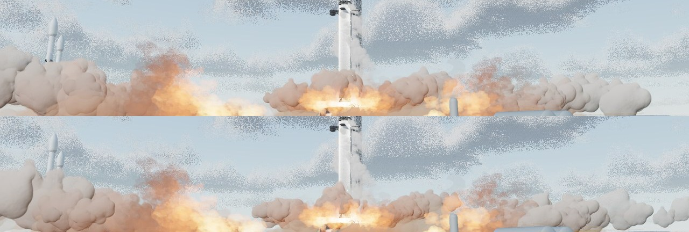

## 25. Vuelo 14 tal como voló: una cadena desde la órbita publicada, que predice la entrada

**Hecho (`mission.js asFlownChain`, `AS_FLOWN`):** aparte de la cadena planificada (la que vuela el
capítulo), una del vuelo real: la órbita tras la inserción publicada (262 × 275 km), la masa del
modelo en el apagado menos el propelente de la inserción (19 s con un Raptor: 13,6 t) y la carga
de 26 Starlink V3 (masa por satélite **no publicada**: parámetro), la desorbitación real
(T+2:12:00–2:12:11) por la ecuación del cohete, y el vuelo libre de Kepler hasta la interfaz de
120 km. Su salida —la hora y el estado en la interfaz— es una **predicción**, no un ajuste.

**Validación (`tools/mission-check.mjs`, cinco pruebas nuevas, en `check:static`):**
- las masas cuadran: apagado − inserción − 26 satélites − desorbitación = 209,2 t en la entrada
  (con 1,5 t por satélite);
- el estado es continuo a través del encendido (0,000 mm) y el vuelo libre conserva la energía
  (Δε/ε = 1,2·10⁻¹⁶);
- **la entrada predicha, T+2:28:52–2:32:17** barriendo lo no publicado (satélites de 0 a 2 t, la fase
  de la órbita), **encierra la publicada, T+2:28:52**, que no entra en el cálculo;
- tras la desorbitación el perigeo queda bajo tierra (−146 km) y la nave entra descendiendo (−1,76°).

**Lectura honesta:** la hora publicada cae en el borde del intervalo, el de los satélites pesados
(≈2 t cada uno). Con lo publicado no se distingue si es la masa real de un V3 o si al modelo le
sobra masa en el apagado (su ascenso está ajustado a la hipótesis circular, §24).

**Pendiente:** que el capítulo de la reentrada pueda volar esta cadena (un modo «as flown» frente
al «planned»), con sus propios hitos de planeo, que exigen resolver de nuevo los coeficientes con
las horas reales de transónico y aterrizaje, que las fuentes leídas no dan con fiabilidad.

## 26. Cybertruck Lab (§25): memoria al cerrar

El modelo se conserva al cerrar el Lab (decisión del usuario del 20-10, auditoría §9: reabrir es
instantáneo). Política adaptativa añadida sin contradecirla: en un equipo justo de memoria (nivel
de calidad bajo, o ≤ 4 GB según `navigator.deviceMemory`) se liberan al cerrar las copias en la GPU
de sus búferes de vértices y sus texturas, que es lo escaso. Los datos siguen en la página, así que
three.js los vuelve a subir en el primer fotograma del Lab al reabrir: ni segunda descarga ni nada
que reconstruir; solo ese fotograma es más lento. En los equipos capaces no cambia nada.
`npm run check:cybertruck`: todas sus comprobaciones pasan (entre ellas, reabrir sin volver a pedir
el archivo). `lab.released` cuenta las liberaciones, para la consola.

**Sondas locales bajo demanda (corrección, 8-11):** con la del Roadster ya eran tres, y cada cambio
de sol las volvía a capturar todas en una sola tarea: 18 pasadas de la escena. Por software, la
página quedaba congelada decenas de segundos y el CI de `e438c62` falló (`check:scene`: el clic en
*Guide* agotó sus 30 s justo después de una prueba que cambia el sol). Ahora un cambio de sol solo
las marca como desfasadas; cada una se vuelve a capturar cuando la cámara se acerca a su vehículo
(450 m para Starship, 150 m para los coches), **una por fotograma como mucho**, y hasta entonces ese
vehículo usa la sonda común. Mejor también para un visitante: ninguna captura de vehículos que no
está mirando.

## 27. Compresión de texturas y geometría (§33): qué aplica de verdad

Medido en los GLB del repositorio (8-11): las imágenes incluidas suman **13,8 MB de 113 MB** (H2R
1,2 de 40,2 · Model Y 7,1 de 32,6 · Porsche 2,7 de 28,1 · Cybertruck 2,8 de 12,6, ya en WebP). El
resto es geometría. Y la mayor parte de las texturas de la escena **no viajan en archivos**: se
generan por código al arrancar (§20), así que KTX2/Basis no se les puede aplicar.

- **KTX2 en las 25 imágenes de los GLB de Blender:** apenas cambia la descarga (13,8 MB, que gzip y
  el formato ya comprimen); su ventaja real sería la memoria de la GPU (una PNG de 2048² ocupa
  ≈16 MB descomprimida; en KTX2/UASTC, ≈4) y la decodificación. Exige el codificador `basisu` y el
  transcodificador en `vendor/` (más WebAssembly que mantener) y volver a validar las texturas
  normales y la oclusión horneada. **Pendiente de medir** la memoria de texturas real en el equipo
  del usuario antes de decidir.
- **Geometría:** ya estudiado y descartado el 17-10 (README, «Lo que se descartó»): el 92 % son
  vértices `float32`, gzip de Pages ya los deja en ≈48 MB, y meshopt sin pérdida solo ganaba ≈20 %
  en el Model Y. Ahora, además, sus neumáticos ceden a un torno a distancia (§23), que es memoria y
  dibujo, no descarga.

## 28. Liberación de recursos (§32): sin fugas en los ciclos de las secuencias (medido)

`renderer.info.memory` (geometrías y texturas vivas en la GPU, fiable también por software) y los
programas compilados, tras arrancar y detener tres veces cada secuencia (calidad media):

| Tras 3 ciclos de… | Geometrías | Texturas | Programas |
|---|---|---|---|
| (arranque) | 1 744 | 160 | 174 |
| lanzamiento | 1 744 · 1 744 · 1 744 | 160 · 160 · 160 | 174 · 174 · 174 |
| reentrada | 1 744 · 1 744 · 1 744 | 160 · 160 · 160 | 183 · 183 · 183 |
| F-16 | 1 744 · 1 744 · 1 744 | 160 · 160 · 160 | 189 · 189 · 189 |
| Porsche | 1 744 · 1 756 · 1 756 | 160 · 163 · 163 | 189 · 232 · 233 |
| H2R | 1 756 · 1 756 · 1 756 | 163 · 163 · 163 | 233 · 233 · 233 |
| sol 60° ↔ 20° | 1 756 · 1 756 · 1 756 | 162–163 | 233 |

Nada crece de un ciclo al siguiente: el único aumento es el primero de cada cosa (programas que se
compilan la primera vez que se dibujan; las marcas y el humo del Porsche, creados al conducirlo), y
después se mantiene. Los cambios de sol no acumulan (las sondas liberan su mapa al rehacerse).

## 29. Exposición cinematográfica frente a neutral (§7)

La escena usa ACES Filmic (contraste y saturación de cine; desplaza algo los tonos y quema los
blancos antes). El modo fotográfico (**O**) ofrece ahora **Tone: Filmic (cinematic)** o **Neutral
(inspection)** — Khronos PBR Neutral, de three r170, pensado para ver los colores de los materiales
tal como son —, con la exposición compensada (ACES divide entre 0,6 por dentro) para que ambos se
vean igual de luminosos (`environment.js setToneMapping`). *Reset* y *Close* lo devuelven también.
Con Neutral el cielo recupera su azul, la carrocería blanca no se quema y el rojo es más fiel.

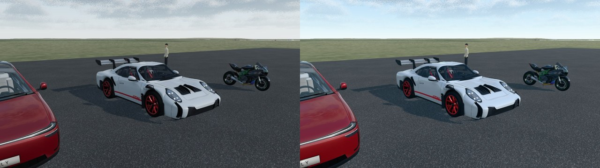

## 30. Refactor (§36): el modelo de trayectoria sale de `launch.js`

`src/sim/launch.js` tenía 1860 líneas que mezclaban dos cosas: el modelo puro de la trayectoria
(perfil integrado, fases, empuje por motor, hitos, captura del booster) y la escena (plumas,
cámaras, hardware). El modelo pasa **sin cambiar una línea** a `src/sim/launchModel.js` (749
líneas); `launch.js` (1127) importa lo que usa y lo reexporta (`export * from './launchModel.js'`),
así que todo `import … from './launch.js'` sigue funcionando y las pruebas no cambian.

Lo único que hubo que tocar es la prueba de sabotaje de `tools/cloud-check.mjs`: aplicaba sus
mutaciones al texto de `launch.js`, y tres de ellas (`staging`, `shipmass`, `kink`) apuntan ahora a
código de `launchModel.js`. El gancho reparte cada mutación a su archivo y, si el texto que espera
ya no está, **falla** («mutation … not applied») en vez de dar por buena una mutación que no se
aplicó. Las siete mutaciones se rechazan y `npm run check:static` termina con código 0.
