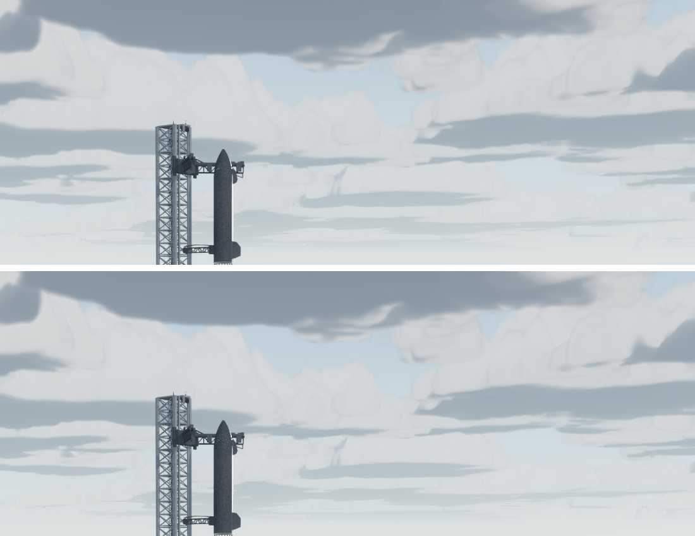

# Rendimiento medido en la RTX 3070 (11-11-2026)

Primera medición del proyecto en una GPU real. Esta sesión corrió en el PC del usuario: RTX 3070 (8 GB, controlador 581.29), i7-12700F, 32 GB, pantalla de 3440 × 1440 a 144 Hz, Chrome con ANGLE sobre Direct3D 11. Todas las cifras son de esa máquina, con la ventana maximizada (lienzo de 3424 × 1345, densidad de píxeles 1) y la escena tal como la recibe un visitante: calidad alta, la página sin saber que la maneja un programa (`--disable-blink-features=AutomationControlled`).

## Cómo se mide

- `npm run bench:gpu` (`tools/gpu-bench.mjs`): abre Chrome con la GPU real, carga la escena con `?gpu`, recorre vistas fijas y da para cada una los FPS, el tiempo de GPU y de CPU por fotograma y el tiempo de GPU de cada pasada. Opciones: `--views`, `--launch`, `--objects`, `--q "off=ao"` (una configuración por `--q`), `--shots carpeta`, `--eval código`, `--json salida`.
- `?gpu` en la URL (`src/core/gpuProfiler.js`): temporizadores de GPU (`EXT_disjoint_timer_query_webgl2`) por pasada: el mapa de sombras, cada pasada del compositor y la marcha de las nubes. `?gpu=objects` reparte además la pasada de la escena por grupos (las nubes, el suelo, cada expositor…). Se lee en la consola con `__vc.gpu.report()`.
- Interruptores al cargar, para aislar piezas: `?off=ao,ssr,stillaa,bloom,pcss,shadows,cloudshadows,probes`, `?pr=1`, `?shadow=4096`, `?msaa=0` y `?clouds=N` (pasos de la marcha; 0, la capa plana).

## Qué costaba (antes, `afb98f9`)

Vista general, ms de GPU por fotograma (media de ≈3 s):

| Apagado | GPU | FPS |
|---|---|---|
| nada | 76 | 12–13 |
| PCSS | 76 | 13 |
| sombras de las nubes | 77 | 13 |
| MSAA | 83 (ruido) | 13 |
| **marcha de las nubes** (`clouds=0`) | **14** | **68** |

Por objetos: la cúpula de nubes, 62 ms de los 76; el resto de la escena, ≈10; todo el posprocesado (oclusión, reflejos del mar, antialiasing quieto, bloom, salida), ≈5. El mapa de sombras de 8 192, con su caché, ≈0,1–1 ms. **Las sospechas del informe anterior (PCSS, sombras de 8 192, MSAA, densidad de píxeles) no eran el problema; eran las nubes.**

## Qué se cambió

1. **Nubes repartidas entre fotogramas** (`src/core/cloudsTemporal.js`). Cada fotograma marcha un píxel de cada bloque de 4 × 4, a resolución completa, en orden de Bayer; los demás reutilizan lo que ya tenían, reproyectado con la distancia de la nube que ven (la técnica de *Horizon Zero Dawn*, Schneider, SIGGRAPH 2015). En 16 fotogramas (≈¼ s) cada píxel se ha vuelto a marchar, y se promedia con su historia, así que queda menos grano que antes. La función de la marcha es la misma, sin un número cambiado. La cúpula marcha por píxel solo para las sondas de reflejos. Coste: **62 → 7 ms**.
   - Antes y después, misma vista y misma GPU (arriba, por píxel; abajo, temporal): 
   - Prueba `tools/clouds-temporal-check.mjs` (en `check:cache`): con la cámara quieta, el cielo difiere del de la marcha por píxel 0,69 niveles de gris de media (de 255); al girar la cámara, las nubes siguen a la vista.
   - Lo que puede notarse: si la vista gira muy deprisa, el borde que entra se ve con detalle de 4 píxeles durante como mucho ¼ s; un cambio de Sol se rehace en 16 fotogramas desde la imagen anterior.
2. **La oclusión ya no se redibuja por la manga de viento** (`gbufferCache.js`). La manga gira cada fotograma, y desde la vista general (≈17 px) obligaba a dibujar otra vez toda la escena opaca para la oclusión: 267 redibujados de 267 fotogramas. Ahora solo cuenta por encima de 48 px. CPU de la vista general: **15 → 10 ms**.
3. **El calentamiento de sombreadores compila lo que se usa** (`main.js`). Al calentar parte a parte, ocultaba también las luces de las partes ocultas (los seis focos y la luz de rebote del foso, y las dos luces de los penachos, dentro de Starship). three.js crea un programa por número de luces, así que casi todo se compilaba dos veces: con 0 luces en el calentamiento y con 9 en el primer fotograma, que se congelaba ≈30 s. Ahora se ocultan solo las piezas dibujables. Programas: **249 → 154**; primera visita: **53–55 → 42–45 s**; **desde la segunda, ≈10 s** (Chrome guarda los programas compilados en disco).

## Después

| Vista | FPS antes | FPS después | GPU después (ms) |
|---|---|---|---|
| Vista general | 12–13 | 47–50 | 18,5–20 |
| Starship, explanada | 12,6 | 46–47 | 21 |
| Starship, motores | — | 54 | 18 |
| Roadster, detalle | — | 48 | 20 |
| F-16 | — | 53 | 18 |
| Porsche | 19 | 44–49 | 20–22 |
| Model Y | — | 49 | 20 |
| Lanzamiento (≈8, 20 y 40 s) | — | 59, 59 y 47 | 16–21 |

## Lo que queda (medido) y lo que no se ha medido

- Lo que más pesa ahora en la vista general: la escena (≈7–8 ms), la marcha de nubes (≈7 ms) y la oclusión (≈2,5–5 ms).
- Las 9 luces locales de Starship se calculan en cada píxel de toda la escena: quitarlas ahorra ≈1,1–1,7 ms y alargan la compilación. No se han tocado (cambiaría la luz del foso y del fuego).
- La CPU va a 6–12 ms por fotograma según la vista: el límite para pasar de 60 Hz está ahí tanto como en la GPU.
- Sin medir todavía: la reentrada, el vuelo del F-16 dentro de las nubes, la conducción y el Cybertruck Lab.
